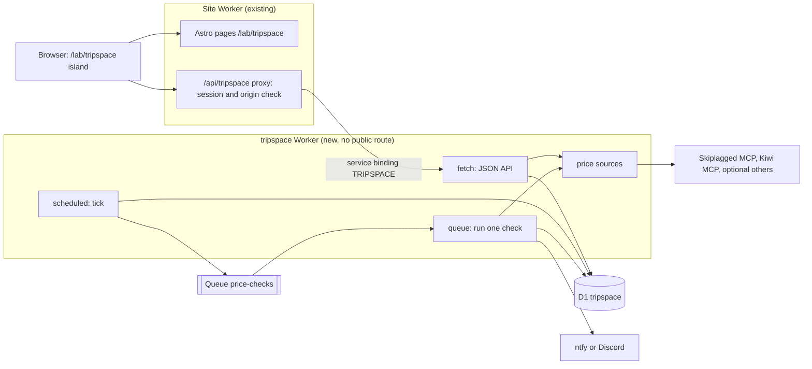

# Tripspace: architecture

> **Status: a browser prototype is built; the shared backend is not.** The
> prototype runs at `codeseys.io/lab/tripspace` and is described in
> [What is built](#what-is-built). The rest of this document is the design for
> the full tool: where prices come from, what it costs, and how the shared
> version is built. Provider facts were checked on 2026-11-15 and 2026-11-16;
> each one links its source in [Sources](#sources), and anything not checked
> first-hand is marked.
>
> How it is used (the journey, the screens, and how a group reaches a decision)
> is in [TRIPSPACE_UX.md](TRIPSPACE_UX.md).

## Short answers

| Question                                                                             | Answer                                                                                                                                                                                                                                                                                                                                                                                |
| ------------------------------------------------------------------------------------ | ------------------------------------------------------------------------------------------------------------------------------------------------------------------------------------------------------------------------------------------------------------------------------------------------------------------------------------------------------------------------------------- |
| Can we build an Expedia-style planner with bookmarks and price watches?              | Yes, as a private tool for you and the people you invite. Search, saved searches, price history and alerts are all feasible. Booking stays on the provider's site through the link each result carries.                                                                                                                                                                               |
| Can we pull prices from Expedia?                                                     | No. Expedia has no API for individuals: Rapid needs a partner contract and the redirect API has paused new applications. Expedia hotel rates are only reachable indirectly, as one row in a metasearch result (Xotelo, Google Hotels through SerpApi). Expedia pages can still be bookmarked, with prices typed in by hand.                                                           |
| Can we pull prices from Skiplagged?                                                  | Yes. Skiplagged runs an official public MCP server (`https://mcp.skiplagged.com/mcp`, no key) with flight search, fare calendars, "anywhere" discovery, hotel search and room-level hotel prices. Kiwi.com runs one for flights (`https://mcp.kiwi.com/`). Scraping either website is prohibited and is not part of this design.                                                      |
| Do we need cron jobs?                                                                | Yes for watching, no for searching. No provider pushes price changes to an individual, so something has to re-run saved searches while no tab is open. One Cloudflare Cron Trigger plus a due-time column covers every watch; there is no cron per watch.                                                                                                                             |
| Can it live under the site's domain?                                                 | Yes. Pages at `/lab/tripspace`, same-origin API at `/api/tripspace/*`, and a second Worker (no public route) that owns the database, the schedule and all provider calls.                                                                                                                                                                                                             |
| Can several people plan one trip, each with different flights, stays and activities? | Yes. A trip has members, and every flight, stay and activity is a plan item listing the members who are on it. Shared things are one item with several participants; separate things are separate items. Overlaps, gaps and cost per member are computed from those items.                                                                                                            |
| What does it add over Wanderlog?                                                     | Wanderlog already covers shared itineraries, and its hotel page says it monitors hotel prices and notifies on a drop; its Pro tier lists flight deals. Its pages do not describe watching a specific flight search, or working out what each traveller still needs. This design does both: an unfilled need becomes a slot that searches by itself and is watched until it is booked. |
| What does it cost to run?                                                            | $0 for providers in the default setup. Cloudflare is $0 on the Free plan if a price check fits in 10 ms of CPU (unmeasured), otherwise the $5/month Workers Paid plan. SerpApi is an optional $25/month add-on.                                                                                                                                                                       |

## What is built

A working prototype at `/lab/tripspace` (`src/pages/lab/tripspace.astro`). It
runs this document's plan model in the browser with live searches, and leaves
out everything that needs the shared backend.

| Part             | In the prototype                                                                                                                                                                               | Missing until the backend exists                                    |
| ---------------- | ---------------------------------------------------------------------------------------------------------------------------------------------------------------------------------------------- | ------------------------------------------------------------------- |
| Trips and people | Several trips per browser, a sample trip, members with their answers, a checklist of everyone's progress, and a "Viewing as" list so one browser can answer, vote and choose as each member    | Personal links, sign-in, one trip shared across devices             |
| Deciding         | Date overlap and best windows, an anywhere search joined across everyone's home airports, options priced per member, approval polls with a favourite, locking the result into the decision log | Poll reminders                                                      |
| Planning         | Gaps, slots, live candidates, choosing an offer, fitting a stay to arrivals, booked prices, the who-is-where timeline, the arrivals board, issues, cost per member                             | Version checks between people editing at once                       |
| Ideas            | Three buckets per member, scores, scheduling for whoever is interested (group, breakout or solo), book-by dates and who is booking                                                             |                                                                     |
| Prices           | Every search recorded as a run-length-encoded series per watch, chosen offers tracked by key, a note when a booked price is undercut                                                           | Checks while nobody has the page open, alerts, the capture registry |

**Storage.** `localStorage` under `tripspace:v1`
(`src/lib/tripspace/store.ts`). What is read back is parsed with the trip
schema; a copy that fails is kept aside under its own key, never half-loaded or
overwritten.

**Search.** `POST /api/tripspace/search`
(`src/pages/api/tripspace/search.ts`) in the site Worker. Skiplagged's endpoint
refuses requests that carry a browser `Origin`, so the page cannot call it
directly. The route is public, so it:

- refuses requests from another site's page (the `Origin` must match);
- parses the body strictly with the schema in `src/lib/tripspace/search.ts`
  and caps it at 2 KB;
- answers an identical search from the edge cache for 10 minutes, unless it
  came back empty;
- limits provider calls with two rate-limit bindings in `wrangler.jsonc`: 30 a
  minute per client address and 120 a minute for the whole site. Without the
  bindings it refuses every search.

Searches run only when someone presses a button. Pricing a shortlist option is
one flight search per distinct set of home airports plus one hotel search.

**Code.** `src/lib/tripspace/` holds the dates, the search contract, the
Skiplagged client, the model (schemas and the pure functions below), the trip
operations, storage and the sample trip, with tests in `model.test.ts` and
`skiplagged.test.ts`. `src/components/tripspace/` holds the app shell
(`Tripspace.tsx`): a sidebar with the stage, the six views and who the browser
is viewing as, and on wide screens a rail with the viewer's next step, who the
trip is waiting on and the decision log (`Briefing.tsx`). The views lay out by
the width of their own column, with container queries, so they use a wide
screen rather than sitting in a centred column.

**Where it differs from the design below.** Provider calls go through the site
Worker, because searching is all the prototype needs. When the tripspace Worker
exists, the route forwards to it, and local storage becomes the signed-out mode.

## Scope and assumptions

- **Private groups, by invitation.** A host on an allow list creates trips and
  invites people by link. A personal link is enough to answer for yourself (in
  or out, dates, votes, interests); changing the shared plan needs sign-in.
  Members see nothing outside their trips. There is no public sign-up: provider
  terms and quotas are written for personal use, and every watch spends that
  budget.
- **Public visitors get the prototype.** `/lab/tripspace` works without an
  account, entirely in the visitor's browser, starting from a sample trip. That
  stays the signed-out mode once the shared version exists, and it is what PR
  preview URLs show, because sign-in is bound to the production origin.
- **Unlisted and `noindex`**, like the other labs. Price history is never shown
  on a public page.
- **No booking, no payments, no traveller documents.** A member is a display
  name, home airports and a head count.
- **Not an itinerary builder.** No map, day routing, reservation import, expense
  settlement or live cursors. Wanderlog does those well; a trip's notes can link
  to one.
- **Sanctioned interfaces only**: documented APIs and the providers' own MCP
  endpoints. No HTML scraping, headless browsers or bot-wall evasion.

## Product model: coarse to fine

A **trip** is a workspace that narrows over time. A **watch** is a saved search
at whatever precision the trip has reached, re-run on a schedule. Narrowing a
trip adds finer watches; it does not delete the coarse ones.

| Stage     | The question                         | Watch kinds                                           | What one check records                                                           |
| --------- | ------------------------------------ | ----------------------------------------------------- | -------------------------------------------------------------------------------- |
| Idea      | Where could we go, and roughly when? | `flight_anywhere`, `flight_calendar`                  | Cheapest fare per destination, or per date                                       |
| Shortlist | Which of these options is best?      | `flight_calendar`, `hotel_area` per option            | Cheapest fare in the window; cheapest and median nightly rate in the area        |
| Plan      | Which flight and which hotel?        | `flight_search`, `flight_itinerary`, `hotel_property` | Cheapest offer matching the filters; price of one exact itinerary; cheapest room |
| Booked    | Did it get cheaper after we booked?  | the same watches, kept until the cancel-by date       | Drop below the price paid                                                        |

An **option** is one candidate "where and when" under a trip (Lisbon, 10 to 17
May). The trip page compares options side by side, per member and for the
group: flight plus hotel total, trend, and the lowest price seen.

A watch also holds **bookmarks**: any URL the user pastes (an Expedia results
page, a Google Flights search) plus optional manual price entries
(`provider = 'manual'`). Sources that cannot be polled still get a place in the
plan and a line on the chart.

### People and plan items

A **member** is a travelling party: one or more people who move together, with
a name, home airports and a head count. A member usually has a signed-in user
behind it but does not need one, so a host can plan for a partner, children or
a friend who has not joined yet. An invitation can hand such a placeholder to
the person it stands for.

A **plan item** is one flight, stay or activity, with the members who are on
it. That one list is how the plan holds what people share and what they do
apart:

| Situation                                 | In the plan                                                         |
| ----------------------------------------- | ------------------------------------------------------------------- |
| Two parties on the same flight            | One flight item, two participants                                   |
| One party flies from another city         | A flight item of their own                                          |
| Someone joins a shared stay two days late | One stay item; that participant has their own first night           |
| Half the group takes a day trip           | One activity item with those participants                           |
| Two people add the same flight separately | Two items with the same identity key; the page offers to merge them |

An item is in one of four states:

| Status    | Meaning                                                                                    | Watches                                                               |
| --------- | ------------------------------------------------------------------------------------------ | --------------------------------------------------------------------- |
| `open`    | A need with nothing chosen: "a flight from SFO for two around 10 May". This is a **slot**. | A search watch (`flight_search` or `hotel_area`)                      |
| `chosen`  | One offer picked: these flight numbers, this hotel                                         | Adds an exact watch (`flight_itinerary` or `hotel_property`)          |
| `booked`  | Paid, with the price recorded                                                              | The same watches until the travel date, alerting under the price paid |
| `dropped` | No longer wanted                                                                           | Paused                                                                |

Activities use the same states but have no watch: this design has no price
source for them. They are entered by hand with a date, a place, a link and a
cost.

### Autofill: gaps become slots

A **gap** is something a member needs for an option that no item covers yet:

- `no_flight`: the member has home airports and no flight to the destination,
  or none back.
- `no_stay`: nights between the member's arrival and departure with no stay.

Arrival and departure come from the member's own flight items. A member with no
home airports (local, or driving) is taken to be there for the option's dates.

"Fill in travel" on an option turns its gaps into proposed slots. Members with
the same home airports and dates share one flight slot, searched for their
combined head count. Members missing the same nights share one stay slot. The
proposal is shown first; nothing is created until someone confirms it, because
each slot spends watch budget and the grouping (who shares a room) is a guess.

A confirmed slot creates its search watch and runs the first search at once.
The results are the slot's candidates. Choosing one copies its details into the
item and starts the exact watch. From then on the scheduler keeps both prices
current.

Gaps are recomputed on every read. When someone moves their flight, the stay
gap that opens or closes shows up for everyone, and "Fill in travel" proposes
only the difference. It never edits or deletes an existing item.

### Seeing overlap

These views are computed from the items when a trip is read. None is stored.

- **Who is where.** A row per member and a column per day. Each row shows when
  that member is there, from their own flight, the nights each of their stays
  covers, nights with no bed, and their activities. Shared stays and
  activities line up across rows.
- **Together windows.** The runs of nights when a chosen set of members is in
  the same place.
- **Issues.** A participant on an activity on a day they are not there; two
  items for one member that overlap in time; the same flight or hotel added
  twice.
- **Cost by member.** An item's cost is split across its participants by head
  count (by head count and nights for a stay) unless a share is entered by
  hand. Options are compared per member as well as in total, because people
  flying from different cities rarely share a cheapest option.
- **Anywhere, for a group.** In the Idea stage, one `flight_anywhere` search
  per distinct home airport, joined on destination and ranked by the group's
  total.

### Deciding together

Getting a group to its first shared decision is the hard part. It has its own
mechanics, described in [TRIPSPACE_UX.md](TRIPSPACE_UX.md):

- **Answers.** Each member says whether they are in, which dates work, a budget
  band and where they fly from. A personal link is enough for these.
- **Polls and the decision log.** A group question has choices, a closing time
  and an outcome. The outcome is a row in the decision log. Changing it later
  adds a row that replaces it; history is not edited.
- **Interests.** An activity idea is an undated item. Each member puts it in one
  of three buckets of their own: reservation needed, want to do, would like to
  do. Who is interested decides whether it becomes a group activity, a breakout
  or a solo plan, and the strongest overlap is scheduled first.
- **Reservations.** An item that has to be booked ahead carries a book-by date
  and the member who will book it.

## Data sources

This is the constraint that shapes everything else. Verified facts:

| Source                                      | Access for one individual                                         | Covers                                                                                   | Cost and limits                                                                                                                   | Use here                                                                                      |
| ------------------------------------------- | ----------------------------------------------------------------- | ---------------------------------------------------------------------------------------- | --------------------------------------------------------------------------------------------------------------------------------- | --------------------------------------------------------------------------------------------- |
| **Skiplagged MCP**                          | Public, no account, no key                                        | Flights, date calendars, anywhere, hotels, hotel rooms, cars, award seats                | Free. "Does not currently enforce strict per-user rate limits, but very heavy automated usage may be throttled or blocked."       | Default source for every watch kind                                                           |
| **Kiwi.com MCP**                            | Public, no key                                                    | Flights (`search-flight`, returns `bookingUrl`)                                          | Free, no published quota                                                                                                          | Second flight source                                                                          |
| **Travelpayouts (Aviasales Data API)**      | Affiliate account and token                                       | Cheapest fare per date or month                                                          | Free. 60 to 600 requests/minute by method. Cached: built from Aviasales users' searches, 48 hours for dated fares, 7 days overall | Optional coarse-stage source                                                                  |
| **Xotelo**                                  | Open, no key                                                      | Hotel rates per OTA (Expedia, Booking.com, Hotels.com, Agoda) keyed by TripAdvisor hotel | Free. No published quota or terms                                                                                                 | Optional per-OTA hotel breakdown                                                              |
| **SerpApi** (Google Flights, Google Hotels) | Self-serve                                                        | Google's results, including `price_insights` (typical range and price history)           | Free 250 searches/month; $25/month for 1,000                                                                                      | Optional cross-check. Scraped data: Google sued SerpApi in December 2025 and the case is open |
| **Duffel**                                  | Self-serve                                                        | Bookable airline offers                                                                  | $0.005 per search beyond 1,500 per booking, so a watcher that never books pays for every search                                   | Not used                                                                                      |
| **Nuitée (LiteAPI)**                        | Self-serve; production key needs a card                           | Live hotel rates                                                                         | Free core endpoints, look-to-book policy (not checked first-hand)                                                                 | Later, if hotel coverage is thin                                                              |
| **Expedia Rapid, Expedia redirect API**     | Partner contract; new redirect-API applications paused            |                                                                                          |                                                                                                                                   | Unavailable                                                                                   |
| **Amadeus Self-Service**                    | Shut down 17 July 2026                                            |                                                                                          |                                                                                                                                   | Unavailable                                                                                   |
| **Skyscanner, Booking.com Demand**          | Partner approval                                                  |                                                                                          |                                                                                                                                   | Unavailable                                                                                   |
| **Hotelbeds**                               | Evaluation key at 50 requests/day; production needs certification |                                                                                          |                                                                                                                                   | Unavailable                                                                                   |
| **Kiwi Tequila**                            | Portal shows partner login only; open sign-up not confirmed       |                                                                                          |                                                                                                                                   | Unavailable                                                                                   |
| **Google Flights**                          | No public API                                                     |                                                                                          |                                                                                                                                   | Unavailable                                                                                   |

Measured against the Skiplagged MCP on 2026-11-16, in five searches:

- The server is stateless JSON-RPC over HTTP, answers as a single server-sent
  event, and returns `structuredContent` with a typed card per result.
- A flight card has a price in USD, a deep link and an `id` that encodes the
  flight numbers
  (`SFO-LIS-2027-05-10-2027-05-17-trip=LX39-LX8226-VY6504,FR8197-EI401-EI61`),
  which is the stable identity `flight_itinerary` needs.
- Flight and hotel searches took 9 to 13 seconds. Limited to three results,
  they returned 4 to 6 KB.
- Prices are for the whole party, and the cheapest itinerary depends on its
  size: the cheapest SFO to LIS round trip was 868 USD for one adult and
  1,820 USD, on different flights, for two.
- An "anywhere" search from SFO returned 52 destinations, each with an airport
  code and a price, in 3.5 seconds. That is enough to join results across home
  airports.
- The endpoint refuses browser requests: a POST with
  `Origin: https://codeseys.io` got 403 `{"error":"Forbidden"}`; the same
  request without an `Origin` got results.
- Hotel prices are per room and night: one hotel quoted 99.37 USD for one room
  and 98.98 USD a room for two.
- Plain "Porto" matched Porto Alegre; "Porto, Portugal" matched Porto. The
  prototype adds the country to every city it searches.
- For several minutes on 2026-11-16 every hotel search came back empty, New
  York included, then results returned. The prototype shows that as "no hotels
  found", never as a price, and does not cache it.
- Skiplagged throttles bursts. About ten searches fired back to back from one
  address got 429 with a `Retry-After` of a few seconds. A burst through the
  deployed preview was refused at the same point; its reply was not recorded.
  Normal use stays below that: a real search takes several seconds, the page
  runs at most three at a time, and pricing two shortlist options (ten
  searches) and searching from four airports went through without a refusal.
  The prototype shows the wait it was given.
- The site's own limit works as configured. A probe route allowed 30 calls a
  minute for one key and refused the 31st. In the bursts above, the throttled
  searches still counted against it, which is why the site's own refusal then
  followed.

### Terms posture

The MCP endpoints are sanctioned programmatic access, but they were published
for assistants answering a person, and Skiplagged's general terms forbid using
"any robot, spider, scraper or other automated means" to "access, monitor or
copy" the site without written permission. Interactive search is squarely the
intended use. Scheduled re-checks are a grey area that this design keeps small
and reversible:

- Volume is small and capped: about 230 provider calls a day at the reference
  load below (one every six minutes), with a daily cap per provider in code.
- The client identifies itself honestly in the MCP `clientInfo` with a contact
  address, honours `Retry-After`, and backs off on errors.
- Each provider has a kill switch. Turning one off stops its calls and keeps its
  history.
- Before scheduled checks are turned on, email Skiplagged and Kiwi describing the
  use and volume. Until they answer, scheduled checks run once a day per watch.
- Stored prices are shown only to the members of the trip they belong to, with
  the provider's link.
- Use stays private and by invitation. A group of invited friends is further
  from "personal use" than one person, so the email above describes the group
  use, and any move toward public sign-up needs a commercial data agreement
  first.

This is an engineering reading of published terms, not legal advice.

## Architecture



**Site Worker** (this repo's existing deployment) gains pages, React islands,
one catch-all API route and one `services` binding. Its `main` entrypoint,
build and bindings are otherwise unchanged.

**tripspace Worker** is a second Worker in this repo under
`workers/tripspace/`, with its own `wrangler.jsonc`, D1 database, queue, cron
trigger and secrets. It has `workers_dev: false`, `preview_urls: false` and no
routes, so the only way in is the service binding. It trusts the
`x-tripspace-user` header because only the site Worker can reach it; the proxy
deletes any client-supplied copy before setting its own. Every route then
checks that user's membership of the trip it touches.

Why two Workers instead of adding a `scheduled` handler to the site:

- The site would need a custom entrypoint (`main: ./src/worker.ts` wrapping
  `handle` from `@astrojs/cloudflare/handler`). That is documented, but this
  site's adapter setup already carries a workaround for SSR reload failures
  (`astro.config.ts`, withastro/astro#16248). The split leaves it alone.
- A broken provider adapter or a runaway schedule cannot take down or slow the
  portfolio, and shows up in its own logs.
- Changing an adapter deploys in seconds instead of going through the Rust,
  WebAssembly and Playwright site build.
- Provider keys never enter the site Worker.
- If the lab outgrows the site, it moves out by changing one binding.

The cost is a second Wrangler config and deploy step. If that proves heavier
than it is worth, the same modules run inside the site Worker behind a custom
entrypoint; the module boundaries below do not change.

### Repository layout

```text
workers/tripspace/
  wrangler.jsonc              D1, queue, cron; no routes
  migrations/0001_init.sql    schema below
  src/index.ts                fetch / scheduled / queue wiring, nothing else
  src/api.ts                  route table
  src/watches.ts              cadence, claims, checks
  src/sources/                mcp-client.ts, skiplagged.ts, kiwi.ts, optional others
  src/notify.ts
  src/capture/policies.json   which suppliers let a price drop be captured, with sources
src/lib/tripspace/                  plan model and trip operations, shared by the page and the Worker (built)
src/pages/api/tripspace/[...path].ts    session, origin check, forward to TRIPSPACE
src/pages/lab/tripspace/index.astro     trip list, or the local prototype when signed out
src/pages/lab/tripspace/[id].astro      trip workspace
src/pages/lab/tripspace/join.astro      accept an invitation
src/components/tripspace/           React islands (built)
```

### tripspace Worker configuration

```jsonc
{
  "name": "tripspace",
  "main": "src/index.ts",
  "compatibility_date": "2026-11-01",
  "workers_dev": false,
  "preview_urls": false,
  "observability": { "enabled": true },
  "triggers": { "crons": ["*/15 * * * *"] },
  "d1_databases": [
    {
      "binding": "DB",
      "database_name": "tripspace",
      "database_id": "<id>",
      "migrations_dir": "migrations",
    },
  ],
  "queues": {
    "producers": [{ "binding": "CHECKS", "queue": "price-checks" }],
    "consumers": [
      {
        "queue": "price-checks",
        "max_batch_size": 1,
        "max_retries": 3,
        "dead_letter_queue": "price-checks-dlq",
      },
    ],
  },
}
```

The site's `wrangler.jsonc` gains one line:

```jsonc
"services": [{ "binding": "TRIPSPACE", "service": "tripspace" }]
```

## Scheduling

Searching is a pull on demand. Watching needs a clock, because the sources only
answer when asked. The clock is one Cron Trigger every 15 minutes and a
`next_check_at` column.

**Tick** (`scheduled`):

1. Expire watches whose travel date has passed, and delete the observations of
   trips archived more than a year ago.
2. Claim due watches and push their due time forward in the same statement, so
   overlapping ticks cannot claim a watch twice and a lost message heals on its
   own an hour later:

   ```sql
   UPDATE watches SET next_check_at = :now + 3600
   WHERE id IN (
     SELECT id FROM watches
     WHERE status = 'active' AND next_check_at <= :now
     ORDER BY next_check_at LIMIT :per_tick
   )
   RETURNING id;
   ```

3. Send one queue message per claimed watch.
4. Send the reminders that have come due: a poll closing within 24 hours, to
   members who have not voted; a book-by date within seven days, to the member
   leading that item. Each is sent once.

**Check** (`queue`, one message per invocation):

1. Load the watch. Skip any source that is switched off or over its daily cap.
2. Call each remaining source with a timeout. One watch makes at most three
   provider calls.
3. Record the sample (see [observations](#data-model)).
4. Evaluate the watch's alert rules and deliver any that fire.
5. Set `next_check_at` from the cadence table, with 10% jitter.

On failure the message is retried with a delay, three times, then dead-lettered.
`consecutive_failures` and `last_error` are stored on the watch; after five
failures in a row the watch is marked `degraded` and the page says so instead of
drawing a stale price as current.

The queue is there for three reasons. Each check gets its own CPU and
subrequest allowance, which matters on the Free plan (10 ms CPU, 50 subrequests
per invocation). A slow provider (10 seconds per search was measured) does not
stall the other watches. Retry, delay and dead-lettering come from the platform
instead of hand-written state.

### Cadence

| Watch                                | Time to departure or check-in | Interval |
| ------------------------------------ | ----------------------------- | -------- |
| `flight_anywhere`, `flight_calendar` | any                           | 24 h     |
| `flight_search`, `flight_itinerary`  | more than 120 days            | 24 h     |
|                                      | 31 to 120 days                | 12 h     |
|                                      | 8 to 30 days                  | 6 h      |
|                                      | 7 days or fewer               | 3 h      |
| `hotel_area`, `hotel_property`       | more than 30 days             | 24 h     |
|                                      | 30 days or fewer              | 12 h     |

A watch can override its interval. "Check now" in the UI runs the same check
immediately, at most once per watch per 10 minutes.

Watches under an option that has not been chosen run every 24 hours whatever
their dates, and watches under a rejected option are paused.

### Capacity at the reference load

Reference load: 30 exact flight watches averaging three checks a day on two
sources, 10 calendar or anywhere watches checked daily with two calls each, and
20 hotel watches averaging 1.5 checks a day on one source. That is 130 checks
and 230 provider calls a day.

| Resource              | Use per day                                          | Free plan limit        |
| --------------------- | ---------------------------------------------------- | ---------------------- |
| Cron Triggers         | 1 trigger, 96 runs                                   | 5 triggers per account |
| Queue operations      | 390 (3 per message)                                  | 10,000                 |
| D1 rows written       | under 2,000, counting index writes                   | 100,000                |
| D1 queries per check  | under 10                                             | 50 per invocation      |
| D1 storage            | under 100 MB a year if every check changed the price | 500 MB per database    |
| Subrequests per check | 4 or fewer (3 provider calls, 1 notification)        | 50                     |
| CPU per check         | **not measured**                                     | 10 ms (30 s on Paid)   |

Provider calls grow in step with active watches, at about four calls per watch
per day in this mix. Group trips add watches quickly: four home airports and one
stay are five slots per option, so three shortlisted options are 15 watches
before anything is chosen. Two configured limits bound it: 40 active watches per
trip and 150 in total. Past a limit a slot is still created, marked as not
watched, and can be searched by hand. At 150 watches the ceiling is about 575
provider calls a day, one every two and a half minutes. Queue operations and
row writes grow by the same factor of 2.5 and stay under a tenth of their
limits. Worst-case storage becomes 250 MB a year, which is why the tick prunes
old trips.

A member with a trip open re-reads it every 30 seconds. An unchanged trip is
answered from one indexed read (see `rev` below), so five people with the page
open for an hour add 600 requests a day.

## Data model

D1 (SQLite). Times are Unix seconds. Money is integer minor units with an ISO
currency code, never floating point. Dates are `YYYY-MM-DD`.

```sql
CREATE TABLE trips (
  id           TEXT PRIMARY KEY,
  title        TEXT NOT NULL,
  stage        TEXT NOT NULL CHECK (stage IN ('idea', 'shortlist', 'plan', 'booked', 'archived')),
  window_start TEXT,
  window_end   TEXT,
  currency     TEXT NOT NULL DEFAULT 'USD',
  notes        TEXT NOT NULL DEFAULT '',
  notify_url   TEXT,
  rev          INTEGER NOT NULL DEFAULT 0,
  created_by   TEXT NOT NULL,
  created_at   INTEGER NOT NULL,
  updated_at   INTEGER NOT NULL
);

CREATE TABLE members (
  id           TEXT NOT NULL PRIMARY KEY,
  trip_id      TEXT NOT NULL REFERENCES trips (id) ON DELETE CASCADE,
  user_id      TEXT,
  role         TEXT NOT NULL CHECK (role IN ('owner', 'member')),
  name         TEXT NOT NULL,
  origins_json TEXT NOT NULL DEFAULT '[]',
  party_json   TEXT NOT NULL,
  rsvp         TEXT NOT NULL DEFAULT 'invited' CHECK (rsvp IN ('invited', 'in', 'maybe', 'out')),
  dates_json   TEXT NOT NULL DEFAULT '[]',
  budget_band  INTEGER CHECK (budget_band BETWEEN 1 AND 3),
  notify_url   TEXT,
  position     INTEGER NOT NULL,
  UNIQUE (id, trip_id),
  CHECK (role <> 'owner' OR user_id IS NOT NULL)
);
CREATE UNIQUE INDEX members_one_per_user ON members (trip_id, user_id) WHERE user_id IS NOT NULL;
CREATE INDEX members_by_user ON members (user_id) WHERE user_id IS NOT NULL;

CREATE TABLE invites (
  token_hash TEXT PRIMARY KEY,
  trip_id    TEXT NOT NULL REFERENCES trips (id) ON DELETE CASCADE,
  member_id  TEXT REFERENCES members (id) ON DELETE CASCADE,
  created_by TEXT NOT NULL,
  expires_at INTEGER NOT NULL,
  uses_left  INTEGER DEFAULT 1 CHECK (uses_left >= 0)
) WITHOUT ROWID;

CREATE TABLE options (
  id          TEXT PRIMARY KEY,
  trip_id     TEXT NOT NULL REFERENCES trips (id) ON DELETE CASCADE,
  label       TEXT NOT NULL,
  destination TEXT,
  depart_date TEXT,
  return_date TEXT,
  status      TEXT NOT NULL CHECK (status IN ('candidate', 'chosen', 'rejected')),
  position    INTEGER NOT NULL
);
CREATE INDEX options_by_trip ON options (trip_id, position);

CREATE TABLE watches (
  id                   TEXT PRIMARY KEY,
  trip_id              TEXT NOT NULL REFERENCES trips (id) ON DELETE CASCADE,
  option_id            TEXT REFERENCES options (id) ON DELETE SET NULL,
  kind                 TEXT NOT NULL CHECK (kind IN (
                         'flight_anywhere', 'flight_calendar', 'flight_search',
                         'flight_itinerary', 'hotel_area', 'hotel_property')),
  label                TEXT NOT NULL,
  query_json           TEXT NOT NULL,
  query_hash           TEXT NOT NULL,
  sources_json         TEXT NOT NULL,
  bookmarks_json       TEXT NOT NULL DEFAULT '[]',
  currency             TEXT NOT NULL DEFAULT 'USD',
  status               TEXT NOT NULL CHECK (status IN ('active', 'paused', 'expired', 'degraded')),
  expires_on           TEXT NOT NULL,
  interval_override_s  INTEGER,
  next_check_at        INTEGER,
  last_checked_at      INTEGER,
  consecutive_failures INTEGER NOT NULL DEFAULT 0,
  last_error           TEXT,
  created_by           TEXT NOT NULL,
  created_at           INTEGER NOT NULL,
  CHECK (status <> 'active' OR next_check_at IS NOT NULL)
);
CREATE INDEX watches_due ON watches (next_check_at) WHERE status = 'active';
CREATE INDEX watches_by_trip ON watches (trip_id);
CREATE UNIQUE INDEX watches_unique_query ON watches (trip_id, kind, query_hash);

CREATE TABLE items (
  id              TEXT NOT NULL PRIMARY KEY,
  trip_id         TEXT NOT NULL REFERENCES trips (id) ON DELETE CASCADE,
  option_id       TEXT REFERENCES options (id) ON DELETE CASCADE,
  kind            TEXT NOT NULL CHECK (kind IN ('flight', 'stay', 'activity')),
  status          TEXT NOT NULL CHECK (status IN ('open', 'chosen', 'booked', 'dropped')),
  title           TEXT NOT NULL,
  start_date      TEXT,
  end_date        TEXT,
  detail_json     TEXT NOT NULL,
  match_key       TEXT,
  search_watch_id TEXT REFERENCES watches (id) ON DELETE SET NULL,
  exact_watch_id  TEXT REFERENCES watches (id) ON DELETE SET NULL,
  quoted_minor    INTEGER,
  paid_minor      INTEGER,
  book_by         TEXT,
  lead_member_id  TEXT REFERENCES members (id) ON DELETE SET NULL,
  reminded_at     INTEGER,
  currency        TEXT NOT NULL DEFAULT 'USD',
  version         INTEGER NOT NULL DEFAULT 1,
  updated_by      TEXT NOT NULL,
  updated_at      INTEGER NOT NULL,
  UNIQUE (id, trip_id),
  CHECK (end_date >= start_date),
  CHECK ((start_date IS NULL) = (end_date IS NULL)),
  CHECK (start_date IS NOT NULL OR (kind = 'activity' AND status = 'open'))
);
CREATE INDEX items_by_trip ON items (trip_id, start_date);
CREATE INDEX items_by_search_watch ON items (search_watch_id) WHERE search_watch_id IS NOT NULL;
CREATE INDEX items_by_exact_watch ON items (exact_watch_id) WHERE exact_watch_id IS NOT NULL;

CREATE TABLE item_participants (
  item_id     TEXT NOT NULL,
  member_id   TEXT NOT NULL,
  trip_id     TEXT NOT NULL,
  from_date   TEXT,
  to_date     TEXT,
  share_minor INTEGER,
  interest    TEXT CHECK (interest IN ('reserve', 'want', 'like')),
  PRIMARY KEY (item_id, member_id),
  FOREIGN KEY (item_id, trip_id) REFERENCES items (id, trip_id) ON DELETE CASCADE,
  FOREIGN KEY (member_id, trip_id) REFERENCES members (id, trip_id) ON DELETE CASCADE
) WITHOUT ROWID;
CREATE INDEX item_participants_by_member ON item_participants (member_id);

CREATE TABLE polls (
  id          TEXT NOT NULL PRIMARY KEY,
  trip_id     TEXT NOT NULL REFERENCES trips (id) ON DELETE CASCADE,
  question    TEXT NOT NULL,
  pick        INTEGER NOT NULL DEFAULT 1 CHECK (pick >= 1),
  closes_at   INTEGER NOT NULL,
  status      TEXT NOT NULL CHECK (status IN ('open', 'decided', 'cancelled')),
  reminded_at INTEGER,
  created_by  TEXT NOT NULL,
  created_at  INTEGER NOT NULL,
  UNIQUE (id, trip_id)
);
CREATE INDEX polls_by_trip ON polls (trip_id, status);

CREATE TABLE poll_choices (
  id        TEXT NOT NULL PRIMARY KEY,
  poll_id   TEXT NOT NULL REFERENCES polls (id) ON DELETE CASCADE,
  label     TEXT NOT NULL,
  option_id TEXT REFERENCES options (id) ON DELETE CASCADE,
  item_id   TEXT REFERENCES items (id) ON DELETE CASCADE,
  position  INTEGER NOT NULL,
  UNIQUE (id, poll_id),
  CHECK (option_id IS NULL OR item_id IS NULL)
);

CREATE TABLE votes (
  poll_id   TEXT NOT NULL,
  choice_id TEXT NOT NULL,
  member_id TEXT NOT NULL,
  trip_id   TEXT NOT NULL,
  favourite INTEGER NOT NULL DEFAULT 0 CHECK (favourite IN (0, 1)),
  PRIMARY KEY (choice_id, member_id),
  FOREIGN KEY (poll_id, trip_id) REFERENCES polls (id, trip_id) ON DELETE CASCADE,
  FOREIGN KEY (choice_id, poll_id) REFERENCES poll_choices (id, poll_id) ON DELETE CASCADE,
  FOREIGN KEY (member_id, trip_id) REFERENCES members (id, trip_id) ON DELETE CASCADE
) WITHOUT ROWID;
CREATE UNIQUE INDEX votes_one_favourite ON votes (poll_id, member_id) WHERE favourite = 1;

CREATE TABLE decisions (
  id          TEXT PRIMARY KEY,
  trip_id     TEXT NOT NULL REFERENCES trips (id) ON DELETE CASCADE,
  poll_id     TEXT REFERENCES polls (id) ON DELETE SET NULL,
  summary     TEXT NOT NULL,
  decided_by  TEXT NOT NULL,
  decided_at  INTEGER NOT NULL,
  replaces_id TEXT REFERENCES decisions (id) ON DELETE SET NULL
);
CREATE INDEX decisions_by_trip ON decisions (trip_id, decided_at);

CREATE TABLE observations (
  id            INTEGER PRIMARY KEY,
  watch_id      TEXT NOT NULL REFERENCES watches (id) ON DELETE CASCADE,
  provider      TEXT NOT NULL,
  first_seen_at INTEGER NOT NULL,
  last_seen_at  INTEGER NOT NULL,
  price_minor   INTEGER,
  currency      TEXT NOT NULL,
  detail_json   TEXT NOT NULL
);
CREATE INDEX observations_series ON observations (watch_id, provider, last_seen_at DESC);

CREATE TABLE alert_rules (
  id            TEXT PRIMARY KEY,
  watch_id      TEXT NOT NULL REFERENCES watches (id) ON DELETE CASCADE,
  kind          TEXT NOT NULL CHECK (kind IN ('below', 'below_paid', 'drop_pct', 'new_low', 'available')),
  threshold     INTEGER,
  armed         INTEGER NOT NULL DEFAULT 1,
  last_fired_at INTEGER
);
CREATE INDEX alert_rules_by_watch ON alert_rules (watch_id);

CREATE TABLE alerts (
  id             INTEGER PRIMARY KEY,
  rule_id        TEXT NOT NULL REFERENCES alert_rules (id) ON DELETE CASCADE,
  observation_id INTEGER NOT NULL REFERENCES observations (id) ON DELETE CASCADE,
  fired_at       INTEGER NOT NULL,
  target         TEXT NOT NULL,
  delivered      INTEGER NOT NULL DEFAULT 0,
  error          TEXT
);

CREATE TABLE provider_usage (
  provider TEXT NOT NULL,
  day      TEXT NOT NULL,
  calls    INTEGER NOT NULL DEFAULT 0,
  errors   INTEGER NOT NULL DEFAULT 0,
  PRIMARY KEY (provider, day)
) WITHOUT ROWID;
```

Notes on the parts that are not obvious:

- **Observations are run-length encoded.** `price_minor` is the watch's headline
  number: the cheapest offer that matches the query, or `NULL` when nothing
  matched. A check whose price equals the latest row for that watch and provider
  extends that row; only a changed price inserts one:

  ```sql
  UPDATE observations
  SET last_seen_at = :now, detail_json = :detail
  WHERE id = (
      SELECT id FROM observations
      WHERE watch_id = :watch AND provider = :provider
      ORDER BY last_seen_at DESC LIMIT 1
    )
    AND price_minor IS :price
  RETURNING id;
  ```

  No row back means the price changed or there is no history yet, so the check
  inserts. The comparison is `IS`, not `=`, so that repeated "no offer" checks
  extend one `NULL` row instead of adding a row each time. History is a step
  function, which is how prices behave and what the chart draws. A gap between
  one row's `last_seen_at` and the next row's `first_seen_at` is the honest
  "not observed" interval.

- **An active watch always has a due time.** The claim query skips rows whose
  `next_check_at` is `NULL`, so the table rejects an active watch without one.
  Paused and expired watches keep it `NULL`.
- **`detail_json`** is the three cheapest normalized offers (price, label, link,
  identity key), bounded to about 1 KB. Raw provider responses are not stored.
- **`sources_json`** lists which providers a watch polls and any
  provider-specific reference, because a hotel has a different id at each one:
  `[{"provider":"skiplagged","ref":{"hotelId":"hotel_7981838"}}]`.
- **`query_hash`** is SHA-256 of the canonical `query_json`. It stops duplicate
  watches in a trip and is the cache key for interactive search.
- **Membership is the only access rule.** A row is reachable only through a
  trip the caller is a member of. No table carries a per-user owner column to
  filter on, so there is one check to get right and one place to test it.
- **Participants cannot cross trips.** `item_participants` repeats `trip_id`, and
  both of its foreign keys include it, so the database rejects a member of one
  trip on another trip's item whatever the code does.
- **Items point at watches**, not the other way round. Two slots with the same
  query share one watch, through the unique index on `query_hash`, and one set
  of provider calls. A search or exact watch that no open, chosen or booked
  item points at is paused. Explorer watches (`flight_anywhere`,
  `flight_calendar`) belong to the trip or option directly.
- **`match_key`** is the `Offer.key` of the chosen flight or hotel. Equal keys on
  two items of a trip are the "added twice" signal.
- **Cost of an item** is `paid_minor` if set, else the latest price of its exact
  watch, else of its search watch, else `quoted_minor`, which is typed in.
  `share_minor` overrides one participant's part.
- **Booking facts** (who sold it, the fare or rate type, the last day of free
  cancellation) are stored inside `detail_json` once an item is booked. They
  are what the capture registry is looked up with. Confirmation numbers and
  logins are never stored.
- **`from_date` and `to_date`** narrow one participant's part of a stay. They are
  `NULL` for someone on the whole item.
- **An idea is an undated activity.** Only an `open` activity may have no dates.
  Scheduling it sets the dates and moves it to `chosen`; nothing is copied to
  another table.
- **`interest`** is one member's bucket for an activity: `reserve` (reservation
  needed), `want` or `like`. It is personal, so the same idea can be a must for
  one person and filler for another.
- **`book_by` and `lead_member_id`** are facts about the item, not about anyone's
  interest: when it has to be booked, and who is doing it.
- **Votes cannot cross polls or trips.** A vote repeats `poll_id` and `trip_id`,
  and its three foreign keys tie the choice to the poll and the member to the
  poll's trip. A member approves any number of choices and marks at most one
  favourite per poll, which the partial unique index enforces.
- **The decision log is append-only.** Changing a decision adds a row whose
  `replaces_id` names the old one.
- **`version` and `rev`.** An item update names the version it was read at:

  ```sql
  UPDATE items
  SET title = :title, detail_json = :detail, version = version + 1,
      updated_by = :user, updated_at = :now
  WHERE id = :id AND version = :version
  RETURNING version;
  ```

  No row back means someone else changed it first; the API answers 409 with the
  current item. Every write to a trip's rows also increments `trips.rev` in the
  same D1 `batch()`, which D1 runs as one transaction. `rev` is the trip's
  `ETag`, so a client that is up to date gets a 304.

- **Links are stored hashed.** A link carries a random 128-bit token and the
  table holds its SHA-256. A personal link names a `member_id` and has no use
  count, so the same person can open it on a phone and a laptop until it
  expires or they sign in. An open invitation has a use count and creates a new
  member. Accepting either is a single statement, so two people cannot both use
  a one-use link:

  ```sql
  UPDATE invites SET uses_left = uses_left - 1
  WHERE token_hash = :hash AND expires_at > :now
    AND (uses_left IS NULL OR uses_left > 0)
  RETURNING trip_id, member_id;
  ```

- **Currency.** Every v1 source quotes USD natively and that is what is stored
  and what thresholds compare. Showing another currency is a display conversion.

## Contracts

One function per provider serves both search and watching. A watch is a saved
search; a check is that search run again.

```ts
export type WatchKind =
  | 'flight_anywhere'
  | 'flight_calendar'
  | 'flight_search'
  | 'flight_itinerary'
  | 'hotel_area'
  | 'hotel_property'

export type Party = {
  adults: number
  children: number
  infantsLap: number
  infantsSeat: number
}

export type FlightSearchQuery = {
  v: 1
  origins: string[] // IATA, 1 to 3
  destinations: string[] // IATA, 1 to 3
  depart: string // YYYY-MM-DD
  return?: string
  pax: Party
  cabin: 'economy' | 'premium' | 'business' | 'first'
  maxStops?: 0 | 1 | 2
  airlines?: { include?: string[]; exclude?: string[] }
  hiddenCity: boolean // default false, so sources stay comparable
  selfTransfer: boolean // default false
}

export type Offer = {
  key: string // stable identity: flight numbers, or hotel plus room
  priceMinor: number
  label: string
  link?: string // the provider's own link, passed through unchanged
  tags: string[] // 'nonstop', 'refundable', 'hidden-city', ...
}

export type Sample = {
  priceMinor: number | null // cheapest matching offer
  currency: string
  offers: Offer[] // sorted by price
  freshness: 'live' | 'cached'
  fetchedAt: number
}

export interface PriceSource {
  readonly id: 'skiplagged' | 'kiwi' | 'travelpayouts' | 'xotelo' | 'serpapi'
  readonly kinds: ReadonlySet<WatchKind>
  /** One provider round trip. Rejects with SourceError; never returns a guessed price. */
  check(query: WatchQuery, ref: unknown, signal: AbortSignal): Promise<Sample>
}

export class SourceError extends Error {
  constructor(
    readonly reason:
      'rate_limited' | 'unavailable' | 'bad_response' | 'timeout',
    readonly retryAfterS?: number,
  ) {
    super(reason)
  }
}
```

`WatchQuery` is the union of the per-kind query types; the others follow the
shape of `FlightSearchQuery`. `flight_itinerary` runs the same search as
`flight_search` and reads the offer whose `key` matches.

The plan's own contract is implemented in the prototype and is the code:
`src/lib/tripspace/model.ts` holds the schemas and the pure functions
(`findGaps`, `findIssues`, `unusedNights`, `costByMember`, `optionCost`,
`nextAsks`, `memberStatus`, `interestScore`, `audience`, `tally`, `bestWindows`,
`arrivals`, `presence`, `recordObservation`), and `src/lib/tripspace/actions.ts` every change
to a trip. They are pure, so the Worker will import them unchanged and the gaps
a member sees stay the gaps autofill acts on.

The capture registry is not built. Its entry will be:

```ts
/** One entry of the capture registry, a JSON file in the repository. */
export type CapturePolicy = {
  supplier: string
  capturable: 'yes' | 'no' | 'unknown'
  how?: string
  returns?: 'refund' | 'credit' | 'points'
  excludes?: string[]
  source: string // the supplier's own page
  checked: string // YYYY-MM-DD
}
```

Source per watch kind in the default setup:

| Kind                                | Skiplagged tool                                         | Second source              |
| ----------------------------------- | ------------------------------------------------------- | -------------------------- |
| `flight_anywhere`                   | `sk_destinations_anywhere`                              |                            |
| `flight_calendar`                   | `sk_flex_departure_calendar`, `sk_flex_return_calendar` | Travelpayouts (optional)   |
| `flight_search`, `flight_itinerary` | `sk_flights_search`                                     | Kiwi `search-flight`       |
| `hotel_area`                        | `sk_hotels_search`                                      |                            |
| `hotel_property`                    | `sk_hotel_details`                                      | Xotelo `/rates` (optional) |

API, all under `/api/tripspace` on the site and forwarded unchanged:

| Route                                                                       | Purpose                                                                                                                              |
| --------------------------------------------------------------------------- | ------------------------------------------------------------------------------------------------------------------------------------ |
| `POST /search`                                                              | Run one search now. Built in the prototype as a site route (see [What is built](#what-is-built)); later forwarded to the Worker      |
| `GET, POST /trips` · `GET, PATCH, DELETE /trips/:id`                        | The caller's trips. Reading one returns its members, options, items and watches, with `rev` as the `ETag`. Creating one needs a host |
| `POST /trips/:id/members` · `PATCH, DELETE /members/:id`                    | Placeholder members; a member's own answers (in or out, dates, budget band, airports) and details; leaving; removal by an owner      |
| `POST /trips/:id/invites` · `POST /invites/accept`                          | Create a personal or open link; start a guest session, join a trip or take over a placeholder                                        |
| `POST /trips/:id/options` · `PATCH, DELETE /options/:id`                    | Options                                                                                                                              |
| `GET /options/:id/gaps`                                                     | Gaps and the slots proposed for them. Read-only                                                                                      |
| `POST /trips/:id/items` · `PATCH, DELETE /items/:id`                        | Items and their participants. `POST` takes a list, which is how a proposal is applied; `PATCH` carries `version`                     |
| `POST /items/:id/choose`                                                    | Fill an item from one offer of its search watch                                                                                      |
| `POST /items/:id/merge`                                                     | Fold a duplicate item into this one                                                                                                  |
| `PUT /items/:id/interest`                                                   | Set or clear the caller's own bucket for an idea                                                                                     |
| `POST /trips/:id/polls` · `PUT /polls/:id/votes` · `POST /polls/:id/decide` | Open a poll; replace the caller's votes; close it and write the decision                                                             |
| `GET /trips/:id/decisions`                                                  | The decision log                                                                                                                     |
| `POST /trips/:id/watches` · `PATCH, DELETE /watches/:id`                    | Explorer watches, bookmarks, pause and resume                                                                                        |
| `GET /watches/:id/observations`                                             | Price series per provider                                                                                                            |
| `POST /watches/:id/check`                                                   | Check now                                                                                                                            |
| `POST /watches/:id/observations`                                            | Manual price entry                                                                                                                   |
| `PUT /watches/:id/rules`                                                    | Replace alert rules                                                                                                                  |
| `GET /status`                                                               | Provider switches, today's usage and watch counts against their caps, degraded watches                                               |

## Alerts

Rules are evaluated right after a check writes its sample.

| Rule         | Fires when                                                           | `threshold`  |
| ------------ | -------------------------------------------------------------------- | ------------ |
| `below`      | price is at or under a fixed amount                                  | minor units  |
| `below_paid` | price is under the `paid_minor` of a booked item that uses the watch |              |
| `drop_pct`   | price is this far under the median of the previous 7 days            | basis points |
| `new_low`    | price is under every earlier observation of the watch                |              |
| `available`  | a watch with no matching offer gets one                              |              |

A rule fires once and disarms. It re-arms when the condition stops holding, so
a price sitting under the threshold does not alert on every check.

Delivery is one POST per target. The targets are the trip's channel and the
personal channel of each member on an item that uses the watch. A channel is an
ntfy topic or Discord webhook URL that a member pastes in. Only addresses under
`https://ntfy.sh/` and `https://discord.com/api/webhooks/` are accepted, so the
Worker never fetches an arbitrary URL on a member's behalf. Every attempt is
logged in `alerts`.

A `below_paid` alert carries more than a price. The item records who sold the
booking and its fare or rate type, and a capture registry says whether that
supplier lets a drop be captured and how. The alert gives the saving, what
comes back and the steps; a supplier that does not allow it gets no alert. The
services that do this for a fee, and why none can be plugged in, are under
"After booking" in [TRIPSPACE_UX.md](TRIPSPACE_UX.md).

## Auth and privacy

- **Sign-in.** The proxy route reads `Astro.locals.user`, which
  `src/middleware.ts` already fills from the signed OIDC session cookie. A
  request with neither that nor a guest cookie gets 401. Members need an
  identity provider they already have
  an account with, so the plan is Google as the generic OIDC issuer
  (`docs/AUTH_OIDC.md`). Read against Google's discovery document, the existing
  flow matches: authorization code with S256 PKCE, client secret in the token
  request body, RS256 ID tokens. It has not been run. Two changes to
  `src/lib/auth.ts` come first:
  - `handleCallback` always redirects to `/profile`. Sign-in needs a return
    path, taken from a fixed list of paths on this origin, so that accepting an
    invitation ends on the join page.
  - The session expires when the ID token does, usually within about an hour,
    although the cookie lasts 30 days. A planning tool needs the session to
    have its own lifetime.
- **Authorization.** The proxy forwards the signed-in user id as
  `x-tripspace-user`, or failing that the guest cookie described below. The
  tripspace Worker resolves the trip of whatever the route names, then looks up
  the caller's membership. There is one function for this and no route skips
  it. A non-member gets 404, the same answer as for a trip that does not exist.
  Only ids on the `TRIPSPACE_HOST_IDS` list can create a trip.
- **Three levels.** A guest can read the trip and change only what is about
  themself: their answers, their votes, their interests, and new ideas. A
  signed-in member can also change the shared plan: items, slots, watches and
  polls. An owner also manages members, links, decisions and deletion. Anything
  that spends provider calls needs at least a signed-in member.
- **Links.** A link is `/lab/tripspace/join#<token>`. The token sits in the URL
  fragment, which browsers do not send to servers, so it stays out of request
  logs; the join page posts it to `/api/tripspace/invites/accept`. A personal
  link starts a guest session as one member: the Worker sets an HttpOnly cookie,
  signed with its own secret, that names the member and expires with the link
  (30 days by default). Signing in while holding it binds the member to that
  user id, not to an email address, and deletes the link. An open link lasts
  seven days and needs sign-in.
- **What a leaked personal link exposes.** Whoever holds it can read that trip
  and answer as that member until an owner revokes it. It cannot change the
  plan, start a search or reach another trip.
- **Cross-site requests.** The site disables Astro's origin check globally
  (`security.checkOrigin: false`), and this is the first cookie-authenticated
  API that changes data. The proxy must reject any non-GET request whose
  `Origin` is not the site's own. The session cookie is `SameSite=Lax`, which
  already keeps it off cross-site POSTs; the origin check is the explicit
  control.
- **What members see.** Everything in their trips, including prices other
  members paid, and nothing else. Leaving or being removed takes a member off
  every item. Deleting a trip deletes its items, watches and price history.
- **What is stored about people.** A user id from the identity provider once
  they sign in, a display name, home airports, a head count, whether they are
  coming, the dates that work, a budget band and an optional notification URL.
  No email addresses, documents or payment details.
- Search inputs (places, dates, party size) go to the providers, as they would
  from their own sites. Nothing else leaves the Worker.
- PR preview versions of the site carry the same `TRIPSPACE` binding. They are
  unauthenticated because sign-in redirects to the production origin, so they
  offer only the local prototype.

## Decisions and alternatives

| Decision                           | Chosen                                                                      | Rejected, and why                                                                                                                                                                                                         |
| ---------------------------------- | --------------------------------------------------------------------------- | ------------------------------------------------------------------------------------------------------------------------------------------------------------------------------------------------------------------------- |
| Where prices come from             | Provider MCP endpoints first, optional keyed APIs behind the same interface | Scraping Expedia, Skiplagged or Google pages: prohibited, brittle, and needs bot-wall evasion. Duffel: bills every search when nothing is booked.                                                                         |
| Scheduler                          | One cron tick, `next_check_at`, queue fan-out                               | A cron per watch: the Free plan allows 5. A Durable Object alarm per watch: no shared view of provider budgets. Workflows: more machinery than a retry needs. GitHub Actions cron: wrong side of the data, coarse timing. |
| Hosting                            | Second Worker behind a service binding                                      | `scheduled` in the site Worker: see [Architecture](#architecture). A separate subdomain: loses the shared session and layout.                                                                                             |
| Storage                            | D1, run-length-encoded observations                                         | KV: no queries over a series. Durable Object SQLite: fine, but the cron and queue handlers want one shared database.                                                                                                      |
| History for sources we cannot poll | Bookmark plus manual price                                                  | Leaving Expedia out entirely: it is where the user will often book.                                                                                                                                                       |
| Charts                             | Hand-written SVG step chart                                                 | A chart library: one chart type does not justify the bundle.                                                                                                                                                              |
| Who is on what                     | One item with a list of participants                                        | A copy of each item per person: a shared stay is entered once per person and overlap has to be guessed by matching. A separate itinerary per person: nothing is shared at all.                                            |
| Filling the plan                   | Gaps proposed as slots and confirmed by a person                            | Creating slots on every change: each one spends watch budget, and who shares a room is a guess.                                                                                                                           |
| Edits by several people            | One row per item, a `version` check, re-read every 30 seconds and on focus  | A Durable Object per trip with WebSockets: live cursors are not needed for a handful of people, and it can be added behind the same API. Saving the trip as one document: the last writer overwrites everyone else.       |
| Sign-in for guests                 | OIDC against a provider guests already use, plus invitation links           | Cloudflare Access: each guest is added to a policy by hand. Emailed sign-in links: needs outbound email to arbitrary addresses.                                                                                           |
| Notifications                      | A webhook URL per trip and per member (ntfy, Discord)                       | Web Push: per-device subscriptions and payload encryption, left for later. Email to members: needs the Workers Paid plan (not checked first-hand).                                                                        |
| Answering before signing in        | A personal link starts a guest session limited to that member's own answers | Sign-in before anything: the first asks are where group trips stall, and every extra step loses people. Answering by typing a name: anyone could answer as anyone.                                                        |
| Per-person priorities              | An interest bucket on the participant row of an undated activity            | A separate wishlist table: an idea would be copied when it is scheduled, and its history would split in two.                                                                                                              |
| Group decisions                    | Approval votes, one favourite, a closing time and an append-only log        | Editing the plan directly: nothing records that a question was settled, so it gets reopened. Ranked-choice counting: harder to explain than it is worth for six people.                                                   |

## Build plan

Each phase ships something usable and ends with a check that can fail.

| Phase                | Builds                                                                                                                                                                                                                                                                                        | Done when                                                                                                                                                                                                                               |
| -------------------- | --------------------------------------------------------------------------------------------------------------------------------------------------------------------------------------------------------------------------------------------------------------------------------------------- | --------------------------------------------------------------------------------------------------------------------------------------------------------------------------------------------------------------------------------------- |
| Prototype (built)    | The page, the plan model and trip operations, live search through a rate-limited site route, local storage, a sample trip.                                                                                                                                                                    | A trip goes from answers to a locked destination, live flight and hotel candidates, chosen offers, a day grid and costs per member in one browser.                                                                                      |
| 0. Spikes            | Recorded fixtures for each Skiplagged and Kiwi tool. CPU time of one check under `wrangler dev` and on a deployed Worker. Service binding from `astro dev` to a local tripspace Worker. Permission emails sent. Google sign-in end to end, with the return path and session lifetime changes. | CPU per check is known, which settles Free versus Paid. Fixtures are committed. A second Google account can sign in and stay signed in.                                                                                                 |
| 1. Shared trips      | The tripspace Worker with D1 and the API, on the full schema, with the host as the only member. Skiplagged and Kiwi sources. The prototype's views on server data; the prototype itself stays as the signed-out mode.                                                                         | Signed in, a trip made on one device reloads on another with its slots, candidates and choices. Signed out, the local prototype still works.                                                                                            |
| 2. Deciding together | Personal links and guest sessions. Answers (in or out, dates, budget band, airports). Anywhere search joined across home airports. Options priced per member. Polls, the decision log, "your next step", and the summary to paste into a group chat.                                          | From a phone with no account, a guest answers the four questions and votes in under two minutes. An automated test calls every route as a guest and as a non-member: the guest can change only their own rows, the non-member gets 404. |
| 3. Watching          | Cron tick, queue consumer, cadence, run-length encoding, usage and watch caps, kill switches, degraded state, step chart.                                                                                                                                                                     | A watch left alone for 48 hours shows the expected number of checks, and a forced provider failure surfaces as degraded, not as a stale price.                                                                                          |
| 4. Alerts            | Rules, trip and member channels, reminders, alert log.                                                                                                                                                                                                                                        | A test watch with a threshold above the current price delivers exactly one notification. A poll closing tomorrow reminds only the members who have not voted, once.                                                                     |
| 5. Planning together | Participants, gaps across members, day grid, arrivals board, issues, cost by member, merging duplicates, ideas and interest buckets, book-by dates, version checks and re-reads.                                                                                                              | Two accounts with different home airports plan one trip and each sees the other's edit within 30 seconds. An idea three people want shows as a breakout with those three on it.                                                         |
| 6. Booked            | Booking facts on items, the price-drop rule, and the capture steps for each supplier. Calendar heat map.                                                                                                                                                                                      | One real group trip planned end to end in the tool, with at least one booked item watched against the price paid.                                                                                                                       |
| 7. As needed         | Travelpayouts, Xotelo, SerpApi, Nuitée sources. Web Push. Live updates. Day routing, link ingestion, local guidance, on-trip mode.                                                                                                                                                            | Driven by gaps found in phase 6.                                                                                                                                                                                                        |

Phase 1 is the largest: it carries the Worker, the schema, auth and most of the
UI. Phase 2 comes before watching because a group that never decides has
nothing to watch. Phases 3 and 4 are small because they reuse the phase 1
`check()` path.

The schema is multi-member from the first migration even though phase 1 has one
member. Adding membership later would mean rewriting every query and migrating
every row; carrying it from the start costs one table and one lookup per
request.

Deployment changes, when phase 1 lands:

- `cloudflare-deploy.yml` applies D1 migrations and deploys the tripspace
  Worker before the site on pushes to `main`, since the site's `services`
  binding needs its target to exist. Pull requests run its unit tests and a
  dry-run deploy.
- The Cloudflare API token needs D1 and Queues edit permissions.
- `vitest.config.mts` includes `workers/tripspace/src/**/*.test.ts`.
- `ARCHITECTURE.md`, `README.md` and `docs/DEPLOYMENT.md` already describe the
  prototype; they gain the backend when it lands.

## Open questions

1. **CPU on the Free plan.** Whether parsing one or two provider responses and
   writing a sample fits in 10 ms is unmeasured. If not, the answer is the
   $5/month Paid plan, not a redesign.
2. **Provider permission.** Whether Skiplagged and Kiwi accept low-volume
   scheduled checks from their MCP endpoints, for a small invited group and not
   only one person. If either says no, that source becomes interactive-only and
   its watches fall back to the other source, Travelpayouts or SerpApi.
3. **Google sign-in.** The flow matches on paper, is untested, and needs the two
   auth changes above. Cloudflare Access is the fallback; each guest would then
   be added to a policy by hand.
4. **Hotel identity across sources.** Skiplagged and Xotelo use different hotel
   ids. Phase 1 asks the user to pick the hotel once per source.
5. **Round trips priced as two one-ways.** Not modelled. A watch is one search.
6. **Seats searched together.** A slot for two people searches two seats at
   once, which measured 1,820 USD against twice 868 USD for single seats.
   Members who will book separately can split the slot; whether that should be
   the default is undecided.
7. **City and airport codes.** A slot to NYC and a chosen flight into EWR must
   count as the same destination. That needs a metro-code table the design
   does not have yet.
8. **Activities.** No price or availability source was evaluated. They stay
   manual until one is.
9. **Capture policies.** A research pass found published support for capturing
   a price drop at three airlines and a refusal at one; most suppliers had no
   clear published answer, and the pages could not be re-fetched here. The
   registry starts empty and every entry needs its source and a check date.

## Sources

Checked first-hand on 2026-11-15 or 2026-11-16 unless marked.

- Skiplagged MCP: [documentation](https://skiplagged.github.io/mcp) (features,
  no authentication, rate-limit statement); live `initialize`, `tools/list` and
  five `tools/call` requests against `https://mcp.skiplagged.com/mcp`.
- Skiplagged [terms](https://skiplagged.com/terms) (automated access clause).
- Kiwi.com MCP: live `initialize` and `tools/list` against `https://mcp.kiwi.com/`.
- Travelpayouts [API rate limits](https://support.travelpayouts.com/hc/en-us/articles/4402565416594-API-rate-limits).
  Cache windows are from the
  [Data API guide](https://support.travelpayouts.com/hc/en-us/articles/203956163-Aviasales-Data-API),
  read by a research agent, not re-fetched.
- [Xotelo](https://xotelo.com/) API documentation.
- SerpApi [pricing](https://serpapi.com/pricing) and
  [Google Flights API](https://serpapi.com/google-flights-api) (`price_insights`).
  [Google LLC v. SerpApi, LLC](https://www.courtlistener.com/docket/72059948/google-llc-v-serpapi-llc/),
  N.D. Cal. 4:25-cv-10826, filed 2025-12-19.
- Duffel [pricing](https://duffel.com/pricing).
- Expedia [redirect API](https://developers.expediagroup.com/travel-redirect-api/api):
  "we have paused all new API applications".
- Amadeus Self-Service shutdown on 2026-07-17:
  [PhocusWire](https://www.phocuswire.com/amadeus-shut-down-self-service-apis-portal-developers)
  and later third-party reports; Amadeus's own notice was not retrievable.
- Astro Cloudflare adapter
  [custom entrypoint](https://docs.astro.build/en/guides/integrations-guide/cloudflare/)
  (`handle` from `@astrojs/cloudflare/handler`).
- Cloudflare [Custom Domains](https://developers.cloudflare.com/workers/configuration/routing/custom-domains/)
  and [multi-Worker development](https://developers.cloudflare.com/workers/development-testing/multi-workers/)
  (service bindings between separate `wrangler dev` and `vite dev` sessions).
- Wanderlog [hotel search](https://wanderlog.com/hotels) ("We monitor for when
  your hotel price drops, and notify you so you can re-book") and
  [flights](https://wanderlog.com/flights) page (Pro lists "flight deals"). No
  Wanderlog page read here describes a watch on a specific flight search; that
  is an absence in what was read, not a tested fact.
- Google's [OpenID configuration](https://accounts.google.com/.well-known/openid-configuration)
  (S256, `client_secret_post`, RS256), read against `src/lib/auth.ts`.
- Cloudflare D1 [`batch()`](https://developers.cloudflare.com/d1/worker-api/d1-database/):
  "Batched statements are SQL transactions." D1
  [foreign keys](https://developers.cloudflare.com/d1/sql-api/foreign-keys/):
  "By default, D1 enforces that foreign key constraints are valid within all
  queries and migrations."
- Cloudflare Workers
  [rate-limit binding](https://developers.cloudflare.com/workers/runtime-apis/bindings/rate-limit/):
  `ratelimits` with `namespace_id` and `simple.limit`, period 10 or 60 seconds.
- Price-drop services (Axel, Autopilot, Soar Travel) and the airline pages
  behind the capture registry are listed in
  [TRIPSPACE_UX.md](TRIPSPACE_UX.md#sources).
- Read by a research agent, not re-fetched: Cloudflare
  [Workers limits](https://developers.cloudflare.com/workers/platform/limits/),
  [Cron Triggers](https://developers.cloudflare.com/workers/configuration/cron-triggers/),
  [D1 limits](https://developers.cloudflare.com/d1/platform/limits/),
  [Queues limits](https://developers.cloudflare.com/queues/platform/limits/) and
  [pricing](https://developers.cloudflare.com/workers/platform/pricing/);
  Nuitée [FAQ](https://docs.liteapi.travel/docs/faq); partner-access pages for
  Skyscanner, Booking.com and Hotelbeds.
