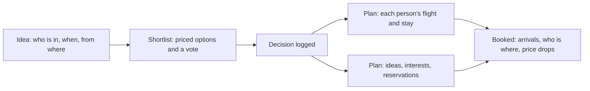

# Tripspace: experience design

> **Status: a prototype of these screens is built** at `/lab/tripspace`; see
> "What is built" in [TRIPSPACE.md](TRIPSPACE.md), which also covers data
> sources, architecture and schema. This document covers what people do with
> the tool. It draws on the owner's stated goal and on two private planning
> notes read on 2026-11-16. Those notes are not linked or quoted here.
>
> In the prototype every screen below works, except the join page: nothing is
> shared between devices yet, so a "Viewing as" list lets one browser answer as
> each member instead.

## The problem

Friend-group trips mostly fail before anything is booked. Someone suggests a
place, the chat agrees it would be great, and nobody turns that into dates and
a destination. The goal is a planner that:

1. gets a group from a loose idea to one shared decision;
2. then lets each person add their own details, which will differ: different
   flights, different arrival days, sometimes different places to stay;
3. shows who wants to do what, so the group can see what to do together, what
   to split up for, and what someone does alone;
4. removes uncertainty about timing, transit and reservations by fetching what
   can be fetched;
5. keeps watching prices, before booking and after.

The first is the hardest, so it comes first in the build. The rest is easier
once a decision exists.

## Principles

| Principle | Why | In the product |
| --- | --- | --- |
| One small ask at a time | "So what's the plan?" is where group trips stall | Each person sees one card: the next thing the trip needs from them |
| Answer before signing up | Every step before the first answer loses people | A personal link is enough to say in or out, give dates, vote and pick interests |
| Decisions close | Groups reopen settled questions | Every group question has a closing time and ends as a line in the decision log |
| One plan, with names on it | People's details differ and overlap | Every item lists who is on it. Nobody has a separate itinerary |
| A real option behind every need | A plan made of placeholders is not a plan | "A flight for two from SFO" is a live search with a price from the moment it exists |
| Say what is still open | Stress comes from not knowing what is unsettled | Gaps, unbooked reservations and conflicts are one visible list |
| The group chat is the channel | The tool cannot post into a private chat | Every state has a two-line summary to paste, with the link |

## The journey

The stage names are the trip `stage` values in the schema.

| Stage | The group's question | What each person does | What the tool does | Ends when |
| --- | --- | --- | --- | --- |
| Idea | Is this happening, and roughly where and when? | Says in, maybe or out. Marks the dates that work. Picks a budget band. Names a home airport. | Shows who has answered. Finds the dates most people share. Searches "anywhere" from every home airport and ranks destinations by the group's total. | The organizer puts two to four options to a vote |
| Shortlist | Which one? | Approves every option that works and marks one favourite | Prices each option per person: their own flight from their own airport, plus a share of the stay. Shows who cannot make each one. | The poll closes and the organizer locks the result into the decision log |
| Plan | How does each of us get there, where do we sleep, and what do we do? | Picks a flight from the candidates in their slot. Joins a stay. Adds ideas and sorts them into three buckets. | Proposes slots from gaps. Ranks ideas by overlap. Flags what must be booked, by when and by whom. Watches every price. | Flights and stays are booked |
| Booked | Is anything left to chance, and can we get money back? | Records what they paid. Books the reservations they lead. | Arrivals board, who-is-where timeline, issues. Watches booked prices and says when a drop can be captured and how. | The trip ends |

## Screens

Open `/lab/tripspace`. The trip switcher and **Acting as** menu stay
available as you move between workspaces. On desktop, the stage indicator
shows `Idea → Shortlist → Plan → Booked`. On phones, the workspace rail
becomes tabs that wrap on the narrowest screens.

Two sample trips let you try the workflows: a planned Lisbon trip and one
with an open vote. **Load sample** adds fresh copies without removing your
own trips. Trips and the acting member are stored in this browser. Switching
members lets you try their view; it doesn't share the trip or send an invite.

### Dashboard

Start here to see group readiness, booked versus estimated spend, and what
to do next. **Needs attention** brings together unanswered questions, date
mismatches, reservations without an owner, price targets, and drops below
what you paid. Fit a stay to someone's arrival dates or claim a reservation
from the queue. The timeline or vote preview shows where the trip stands;
the group matrix and decision log show who is ready and what was decided.

### Coordinator

Use this workspace to decide where and when to go. Fill in each traveler's
answers, compare date overlap, and find windows that work for the group.
Search destinations from the group's home airports, then price each
shortlisted option to compare per-person costs.
Changing the group's search airports or dates clears the displayed fares
until they have been checked for the new inputs.

Mark every option that works and choose one favorite. The organizer locks
the result to record the decision and move to **Plan**. Use **Watch prices**
on a shortlist option to start tracking its searches before the vote is
settled. Copy a nudge to send in an existing group chat; Tripspace doesn't
send it for you.

### Trip Planner

Use the timeline to see when each traveler is there, which stays cover
their nights, and where activities overlap. Fill open flight and stay slots
with live offers, fit stay dates to arrivals, and record bookings and prices
paid. Grouped arrivals help people coordinate rides; the issue list surfaces
uncovered nights, clashes, and reservations without an owner.

Move ideas into **Reservation needed**, **Want to do**, or **Would like to
do** for the acting member. Schedule an idea with its interested travelers
and assign someone to book it if needed.

### Price Monitor

Watch a flight or hotel search independently, or track a planned or booked
item. Press **Check now** to record the lowest matching offer and inspect the
offers returned. Set a target using the total fare for flights or the nightly
rate per room for stays. The chart marks the target and any price paid.

Sample histories are labeled. A successful check replaces the sample series
with live results, even if no prices are available. A failed check leaves
the history labeled as an example.
A drop below what you paid estimates potential savings, not an available
refund or rebooking. Checks run only on demand; the lab doesn't send price
notifications or take action on a booking.

### Join (planned)

In the shared version, a personal link opens a short mobile form for
attendance, dates, budget, and home airport. The browser-local lab doesn't
issue personal links or sync answers across devices.

## How the group mechanics work

### The next step

`nextAsks` returns what the trip needs from one member, in this order:

1. whether they are in;
2. the dates that work;
3. a home airport;
4. open polls they have not voted in, soonest closing first;
5. their slots that have candidates and no choice;
6. reservations they lead, soonest book-by date first.

Nothing is stored for this. It is recomputed from the trip, so an ask
disappears the moment it is answered. "Waiting on" is the same function run
for every member.

### Polls and decisions

- **Voting is approval plus one favourite.** A member approves every choice
  that works for them and may mark one favourite. Choices are ordered by
  approvals, then by favourites. This asks "what can you live with" before
  "what do you want most", which is the question that unblocks a group.
- **A poll has a closing time.** The lab provides a nudge to copy into the
  group's chat. Scheduled reminders need the shared backend.
- **Closing does not decide.** The owner locks the result, which writes a line
  in the decision log. A tie, or a late "I cannot make that week", needs a
  person. The leading choice is shown as what will be locked.
- **Locking an options poll** marks the winning option chosen and the others
  rejected, then moves the trip to the Plan stage. Standalone watches in the
  lab remain independent of the result.
- **Reopening is explicit.** Changing a decision adds a new line that replaces
  the old one. Both stay visible.

### Interests

- Each member's bucket for an idea is their own. The same dinner can be
  "reservation needed" for one person and "would like to do" for another.
- Ideas are ranked by a score: 3 for each reservation-needed, 2 for each want,
  1 for each would-like. The top of the list is what most people care most
  about.
- When an idea is scheduled, the members interested in it become its
  participants. If that is everyone who is coming, it is a group activity. If
  it is some of them, it is a breakout. If it is one, it is a solo plan. The
  label describes who is on it; nobody is added to something they did not pick.
- If anyone put an idea under reservation needed, the card asks for a book-by
  date and for the member who will book it.

### Arrivals

Arrival and departure times come from chosen and booked flight items. Until a
member has chosen a flight, the board shows their slot's dates and marks the
time as unknown.

## After booking: capturing a price drop

Several consumer services watch a booking and try to recover the difference
when the price falls. Their own pages, read on 2026-11-16, say:

| Service | What it does | How it learns of a booking | Cost |
| --- | --- | --- | --- |
| [Axel](https://helloaxel.com/en/faq/flight-repricing) | Books flights and hotels itself, then watches the fare and asks the airline to reprice on a drop. The saving usually comes back as airline credit. It does not change a booking without approval. | The trip is booked through Axel | 25% of the saving, or a membership ($15 the first month, then $10 a month) and no cut |
| [Autopilot](https://withautopilot.com/flights) | Tracks the fare of an existing reservation and claims the lower fare from the airline, keeping the same flights and confirmation number | Connect an inbox, forward the confirmation email, or enter it by hand | 25% of the saving; Pro is $9.99 a month |
| [Soar Travel](https://joinsoar.co/) | A travel assistant that reads bookings from an inbox to plan and manage trips. Its pages read here do not describe price-drop capture. | Connect Gmail, or forward a booking | Free during its beta |

None of the three publishes an API, so none can be plugged into this tool. A
different company, Soar Flights, runs an MCP endpoint for flight search and
booking; it is unrelated to Soar Travel and has not been evaluated as a source.

What this design does itself:

1. **Record the booking's facts on the item.** What was paid, who sold it
   (airline, agency or hotel), the fare or rate type, and the last day of free
   cancellation. No confirmation numbers and no logins.
2. **Keep the exact watch running.** The `below_paid` rule fires when the same
   flight or room costs less than was paid.
3. **Look the supplier up in a capture registry.** One entry per supplier says
   whether a drop can be captured, how, what comes back (refund, credit or
   points), what is excluded, where the supplier says so, and when that was
   last checked. The registry is a JSON file in the repository.
4. **Say what to do.** The alert gives the saving, what the member would get
   back, the steps and any deadline. For a hotel with free cancellation the
   steps are to book the lower rate first and cancel the old booking second.
   A supplier with no entry gets "no policy on file" and a link to its fare
   rules. A supplier that does not allow it gets no alert.
5. **Offer a hand-off.** A member who would rather not do it themselves gets a
   link to a capture service. The tool sends that service nothing.

The tool never holds an airline login or inbox access, and never changes a
booking.

A research pass found published support for capturing a drop on United,
Southwest and Alaska (not its cheapest fare type), and a published refusal on
Ryanair. Those pages could not be re-fetched for this document, and most other
airlines, agencies and hotel groups had no clear published answer. The registry
therefore starts empty, and each entry is added with its source and the date it
was checked.

## Where the earlier notes land

The private notes describe a larger product than this lab. This is where each
part of them lands.

| In the notes | Here | Why |
| --- | --- | --- |
| Three priority buckets per person, with overlap detection | Phase 5, as an interest on each idea | It is the core of group planning and costs one column |
| Real transport options that shape the plan | Phases 1 to 3, flights and stays | Rail, bus and ferry have no evaluated source yet |
| Roles, polls and a decision log | Phase 2, with three levels (guest, member, owner) instead of five roles | "Day captain" becomes the member who leads an item; "viewer" is a guest who does not answer |
| Budget band and cost estimates | The band is one of the first answers; cost per member comes from real prices | An expense ledger is left to tools that already do it |
| Itinerary canvas with a map | The who-is-where timeline, without a map | The timeline answers "who is where"; a map can be added to it |
| Day packing from opening hours and travel times | Phase 7. Until then the tool only reports conflicts | It needs routing and opening-hours sources that have not been evaluated |
| Pulling ideas out of social and video links | Phase 7. Until then: paste a link and type a title | Fetching those sites automatically runs into their terms, and extraction costs a model call per link |
| Local guidance per city | Phase 7 | Generated advice about transit and safety has to be checked against something |
| A chat assistant with tools | Phase 7 | The API is already a set of small operations and can be exposed as tools without redesign |
| On-trip "now and next" and offline use | Phase 7 | The Booked stage's arrivals board is the first step toward it |
| Calendar and PDF export | Phase 7, calendar first | |
| A multi-service backend | Not adopted | One Worker and one D1 database are enough for friend groups |

## Not decided

1. **What a guest can see.** A personal link currently shows the whole trip,
   including prices. Showing a guest only the questions and the options would
   leak less if a link is forwarded, and would make the page less useful.
2. **Whether a poll should lock itself.** Stalling is the problem this tool
   exists for, which argues for locking the leader at the closing time. A late
   objection argues against. The design has the owner lock it.
3. **Bucket names.** The three names come from the notes. "Reservation needed"
   mixes two things, how much someone wants it and whether it must be booked.
   The schema keeps them apart (`interest` and `book_by`); the labels might
   follow.
4. **When a drop is worth an alert.** A credit that expires is worth less than
   a refund. The threshold is a setting, with no default chosen yet.

## Sources

Read first-hand on 2026-11-16 unless marked.

- Axel: [flight repricing](https://helloaxel.com/en/faq/flight-repricing) and
  [what Axel is](https://helloaxel.com/en/faq/what-is-axel).
- Autopilot: [flights](https://withautopilot.com/flights) and
  [pricing](https://withautopilot.com/pricing).
- Soar Travel: [home page](https://joinsoar.co/) and
  [which Soar](https://joinsoar.co/which-soar), which says Soar Flights Inc. is
  a separate business.
- Read by a research agent, not re-fetched: United
  [travel credits](https://www.united.com/en/us/fly/travel/trip-planning/travel-credit.html),
  Southwest
  [lower fare refund options](https://support.southwest.com/helpcenter/article/lower-fare-refund),
  Alaska [Saver fares](https://www.alaskaair.com/content/travel-info/flight-experience/saver),
  Ryanair
  [change costs](https://help.ryanair.com/hc/en-gb/articles/12891192262161-How-much-does-it-cost-to-change-my-flights),
  and the Soar Flights [MCP page](https://flysoar.ai/mcp).
- The two private planning notes were read in the owner's browser. They are the
  source of the bucket model, the decision log and the list in "Where the
  earlier notes land".
