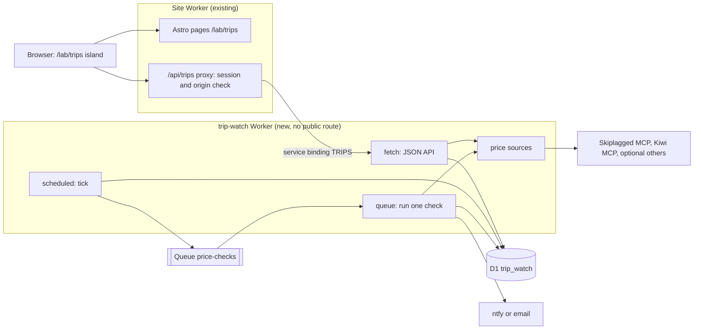

# Trip Watch lab: architecture proposal

> **Status: proposed. Nothing in this document is built.** It answers whether a
> trip planner with price watching can live at `codeseys.io/lab/trips`, what it
> costs, where the data can come from, and how to build it. Provider facts were
> checked on 2026-11-15 and 2026-11-16; each one links its source in
> [Sources](#sources), and anything not checked first-hand is marked.

## Short answers

| Question | Answer |
| --- | --- |
| Can we build an Expedia-style planner with bookmarks and price watches? | Yes, as a personal tool. Search, saved searches, price history and alerts are all feasible. Booking stays on the provider's site through the link each result carries. |
| Can we pull prices from Expedia? | No. Expedia has no API for individuals: Rapid needs a partner contract and the redirect API has paused new applications. Expedia hotel rates are only reachable indirectly, as one row in a metasearch result (Xotelo, Google Hotels through SerpApi). Expedia pages can still be bookmarked, with prices typed in by hand. |
| Can we pull prices from Skiplagged? | Yes. Skiplagged runs an official public MCP server (`https://mcp.skiplagged.com/mcp`, no key) with flight search, fare calendars, "anywhere" discovery, hotel search and room-level hotel prices. Kiwi.com runs one for flights (`https://mcp.kiwi.com/`). Scraping either website is prohibited and is not part of this design. |
| Do we need cron jobs? | Yes for watching, no for searching. No provider pushes price changes to an individual, so something has to re-run saved searches while no tab is open. One Cloudflare Cron Trigger plus a due-time column covers every watch; there is no cron per watch. |
| Can it live under the site's domain? | Yes. Pages at `/lab/trips`, same-origin API at `/api/trips/*`, and a second Worker (no public route) that owns the database, the schedule and all provider calls. |
| What does it cost to run? | $0 for providers in the default setup. Cloudflare is $0 on the Free plan if a price check fits in 10 ms of CPU (unmeasured), otherwise the $5/month Workers Paid plan. SerpApi is an optional $25/month add-on. |

## Scope and assumptions

- **One owner.** Watches run only for signed-in, allow-listed accounts. Every
  row carries `owner_id`, so more users is a policy change, not a schema change.
  Provider terms and quotas are the reason: they are written for personal use.
- **Public visitors see a demo.** `/lab/trips` renders a bundled fixture trip
  with the real components and makes no provider or API calls. This is also
  what PR preview URLs show, because sign-in is bound to the production origin.
- **Unlisted and `noindex`**, like the other labs. Price history is never shown
  on a public page.
- **No booking, no payments, no stored traveller details.**
- **Sanctioned interfaces only**: documented APIs and the providers' own MCP
  endpoints. No HTML scraping, headless browsers or bot-wall evasion.

## Product model: coarse to fine

A **trip** is a workspace that narrows over time. A **watch** is a saved search
at whatever precision the trip has reached, re-run on a schedule. Narrowing a
trip adds finer watches; it does not delete the coarse ones.

| Stage | The question | Watch kinds | What one check records |
| --- | --- | --- | --- |
| Idea | Where could we go, and roughly when? | `flight_anywhere`, `flight_calendar` | Cheapest fare per destination, or per date |
| Shortlist | Which of these options is best? | `flight_calendar`, `hotel_area` per option | Cheapest fare in the window; cheapest and median nightly rate in the area |
| Plan | Which flight and which hotel? | `flight_search`, `flight_itinerary`, `hotel_property` | Cheapest offer matching the filters; price of one exact itinerary; cheapest room |
| Booked | Did it get cheaper after we booked? | the same watches, kept until the cancel-by date | Drop below the price paid |

An **option** is one candidate "where and when" under a trip (Lisbon, 10 to 17
May). The trip page compares options side by side: flight plus hotel total,
trend, and the lowest price seen.

A watch also holds **bookmarks**: any URL the user pastes (an Expedia results
page, a Google Flights search) plus optional manual price entries
(`provider = 'manual'`). Sources that cannot be polled still get a place in the
plan and a line on the chart.

## Data sources

This is the constraint that shapes everything else. Verified facts:

| Source | Access for one individual | Covers | Cost and limits | Use here |
| --- | --- | --- | --- | --- |
| **Skiplagged MCP** | Public, no account, no key | Flights, date calendars, anywhere, hotels, hotel rooms, cars, award seats | Free. "Does not currently enforce strict per-user rate limits, but very heavy automated usage may be throttled or blocked." | Default source for every watch kind |
| **Kiwi.com MCP** | Public, no key | Flights (`search-flight`, returns `bookingUrl`) | Free, no published quota | Second flight source |
| **Travelpayouts (Aviasales Data API)** | Affiliate account and token | Cheapest fare per date or month | Free. 60 to 600 requests/minute by method. Cached: built from Aviasales users' searches, 48 hours for dated fares, 7 days overall | Optional coarse-stage source |
| **Xotelo** | Open, no key | Hotel rates per OTA (Expedia, Booking.com, Hotels.com, Agoda) keyed by TripAdvisor hotel | Free. No published quota or terms | Optional per-OTA hotel breakdown |
| **SerpApi** (Google Flights, Google Hotels) | Self-serve | Google's results, including `price_insights` (typical range and price history) | Free 250 searches/month; $25/month for 1,000 | Optional cross-check. Scraped data: Google sued SerpApi in December 2025 and the case is open |
| **Duffel** | Self-serve | Bookable airline offers | $0.005 per search beyond 1,500 per booking, so a watcher that never books pays for every search | Not used |
| **Nuitée (LiteAPI)** | Self-serve; production key needs a card | Live hotel rates | Free core endpoints, look-to-book policy (not checked first-hand) | Later, if hotel coverage is thin |
| **Expedia Rapid, Expedia redirect API** | Partner contract; new redirect-API applications paused | | | Unavailable |
| **Amadeus Self-Service** | Shut down 17 July 2026 | | | Unavailable |
| **Skyscanner, Booking.com Demand** | Partner approval | | | Unavailable |
| **Hotelbeds** | Evaluation key at 50 requests/day; production needs certification | | | Unavailable |
| **Kiwi Tequila** | Portal shows partner login only; open sign-up not confirmed | | | Unavailable |
| **Google Flights** | No public API | | | Unavailable |

Measured with one flight search and one hotel search against the Skiplagged
MCP (2026-11-16): the server
is stateless JSON-RPC over HTTP, answers as a single server-sent event, and
returns `structuredContent` with a typed card per result. A flight card has a
price in USD, a deep link and an `id` that encodes the flight numbers
(`SFO-LIS-2027-05-10-2027-05-17-trip=LX39-LX8226-VY6504,FR8197-EI401-EI61`),
which is the stable identity `flight_itinerary` needs. Searches limited to
three results returned 4 to 6 KB and took 9 to 10 seconds.

### Terms posture

The MCP endpoints are sanctioned programmatic access, but they were published
for assistants answering a person, and Skiplagged's general terms forbid using
"any robot, spider, scraper or other automated means" to "access, monitor or
copy" the site without written permission. Interactive search is squarely the
intended use. Scheduled re-checks are a grey area that this design keeps small
and reversible:

- Volume is small and capped: about 230 provider calls a day at the reference
  load below (one every six minutes), with a daily cap per provider in code.
- The client identifies itself honestly in the MCP `clientInfo` with a contact
  address, honours `Retry-After`, and backs off on errors.
- Each provider has a kill switch. Turning one off stops its calls and keeps its
  history.
- Before scheduled checks are turned on, email Skiplagged and Kiwi describing the
  use and volume. Until they answer, scheduled checks run once a day per watch.
- Stored prices are shown only to the signed-in owner, with the provider's link.

This is an engineering reading of published terms, not legal advice.

## Architecture



**Site Worker** (this repo's existing deployment) gains pages, React islands,
one catch-all API route and one `services` binding. Its `main` entrypoint,
build and bindings are otherwise unchanged.

**trip-watch Worker** is a second Worker in this repo under
`workers/trip-watch/`, with its own `wrangler.jsonc`, D1 database, queue, cron
trigger and secrets. It has `workers_dev: false`, `preview_urls: false` and no
routes, so the only way in is the service binding. It trusts the
`x-trips-owner` header because only the site Worker can reach it; the proxy
deletes any client-supplied copy before setting its own.

Why two Workers instead of adding a `scheduled` handler to the site:

- The site would need a custom entrypoint (`main: ./src/worker.ts` wrapping
  `handle` from `@astrojs/cloudflare/handler`). That is documented, but this
  site's adapter setup already carries a workaround for SSR reload failures
  (`astro.config.ts`, withastro/astro#16248). The split leaves it alone.
- A broken provider adapter or a runaway schedule cannot take down or slow the
  portfolio, and shows up in its own logs.
- Changing an adapter deploys in seconds instead of going through the Rust,
  WebAssembly and Playwright site build.
- Provider keys never enter the site Worker.
- If the lab outgrows the site, it moves out by changing one binding.

The cost is a second Wrangler config and deploy step. If that proves heavier
than it is worth, the same modules run inside the site Worker behind a custom
entrypoint; the module boundaries below do not change.

### Repository layout

```text
workers/trip-watch/
  wrangler.jsonc              D1, queue, cron; no routes
  migrations/0001_init.sql    schema below
  src/index.ts                fetch / scheduled / queue wiring, nothing else
  src/contract.ts             query, sample and API types (the site imports types only)
  src/api.ts                  route table
  src/domain/                 trips, watches, observations, cadence, alerts (pure functions)
  src/sources/                mcp-client.ts, skiplagged.ts, kiwi.ts, optional others
  src/notify.ts
src/pages/api/trips/[...path].ts    auth, origin check, forward to TRIPS
src/pages/lab/trips/index.astro     trip list, or the demo when signed out
src/pages/lab/trips/[id].astro      trip workspace
src/components/trips/               React islands
public/lab/trips/demo.json          fixture trip for the public demo
```

### trip-watch configuration

```jsonc
{
  "name": "trip-watch",
  "main": "src/index.ts",
  "compatibility_date": "2026-11-01",
  "workers_dev": false,
  "preview_urls": false,
  "observability": { "enabled": true },
  "triggers": { "crons": ["*/15 * * * *"] },
  "d1_databases": [
    { "binding": "DB", "database_name": "trip_watch", "database_id": "<id>", "migrations_dir": "migrations" }
  ],
  "queues": {
    "producers": [{ "binding": "CHECKS", "queue": "price-checks" }],
    "consumers": [
      { "queue": "price-checks", "max_batch_size": 1, "max_retries": 3, "dead_letter_queue": "price-checks-dlq" }
    ]
  }
}
```

The site's `wrangler.jsonc` gains one line:

```jsonc
"services": [{ "binding": "TRIPS", "service": "trip-watch" }]
```

## Scheduling

Searching is a pull on demand. Watching needs a clock, because the sources only
answer when asked. The clock is one Cron Trigger every 15 minutes and a
`next_check_at` column.

**Tick** (`scheduled`):

1. Expire watches whose travel date has passed.
2. Claim due watches and push their due time forward in the same statement, so
   overlapping ticks cannot claim a watch twice and a lost message heals on its
   own an hour later:

   ```sql
   UPDATE watches SET next_check_at = :now + 3600
   WHERE id IN (
     SELECT id FROM watches
     WHERE status = 'active' AND next_check_at <= :now
     ORDER BY next_check_at LIMIT :per_tick
   )
   RETURNING id;
   ```

3. Send one queue message per claimed watch.

**Check** (`queue`, one message per invocation):

1. Load the watch. Skip any source that is switched off or over its daily cap.
2. Call each remaining source with a timeout. One watch makes at most three
   provider calls.
3. Record the sample (see [observations](#data-model)).
4. Evaluate the watch's alert rules and deliver any that fire.
5. Set `next_check_at` from the cadence table, with 10% jitter.

On failure the message is retried with a delay, three times, then dead-lettered.
`consecutive_failures` and `last_error` are stored on the watch; after five
failures in a row the watch is marked `degraded` and the page says so instead of
drawing a stale price as current.

The queue is there for three reasons. Each check gets its own CPU and
subrequest allowance, which matters on the Free plan (10 ms CPU, 50 subrequests
per invocation). A slow provider (10 seconds per search was measured) does not
stall the other watches. Retry, delay and dead-lettering come from the platform
instead of hand-written state.

### Cadence

| Watch | Time to departure or check-in | Interval |
| --- | --- | --- |
| `flight_anywhere`, `flight_calendar` | any | 24 h |
| `flight_search`, `flight_itinerary` | more than 120 days | 24 h |
| | 31 to 120 days | 12 h |
| | 8 to 30 days | 6 h |
| | 7 days or fewer | 3 h |
| `hotel_area`, `hotel_property` | more than 30 days | 24 h |
| | 30 days or fewer | 12 h |

A watch can override its interval. "Check now" in the UI runs the same check
immediately, at most once per watch per 10 minutes.

### Capacity at the reference load

Reference load: 30 exact flight watches averaging three checks a day on two
sources, 10 calendar or anywhere watches checked daily with two calls each, and
20 hotel watches averaging 1.5 checks a day on one source. That is 130 checks
and 230 provider calls a day.

| Resource | Use per day | Free plan limit |
| --- | --- | --- |
| Cron Triggers | 1 trigger, 96 runs | 5 triggers per account |
| Queue operations | 390 (3 per message) | 10,000 |
| D1 rows written | under 2,000, counting index writes | 100,000 |
| D1 queries per check | under 10 | 50 per invocation |
| D1 storage | under 100 MB a year if every check changed the price | 500 MB per database |
| Subrequests per check | 4 or fewer (3 provider calls, 1 notification) | 50 |
| CPU per check | **not measured** | 10 ms (30 s on Paid) |

## Data model

D1 (SQLite). Times are Unix seconds. Money is integer minor units with an ISO
currency code, never floating point. Dates are `YYYY-MM-DD`.

```sql
CREATE TABLE trips (
  id           TEXT PRIMARY KEY,
  owner_id     TEXT NOT NULL,
  title        TEXT NOT NULL,
  stage        TEXT NOT NULL CHECK (stage IN ('idea', 'shortlist', 'plan', 'booked', 'archived')),
  origins_json TEXT NOT NULL,
  party_json   TEXT NOT NULL,
  window_start TEXT,
  window_end   TEXT,
  budget_minor INTEGER,
  currency     TEXT NOT NULL DEFAULT 'USD',
  notes        TEXT NOT NULL DEFAULT '',
  created_at   INTEGER NOT NULL,
  updated_at   INTEGER NOT NULL
);
CREATE INDEX trips_by_owner ON trips (owner_id, updated_at DESC);

CREATE TABLE options (
  id          TEXT PRIMARY KEY,
  trip_id     TEXT NOT NULL REFERENCES trips (id) ON DELETE CASCADE,
  label       TEXT NOT NULL,
  destination TEXT,
  depart_date TEXT,
  return_date TEXT,
  status      TEXT NOT NULL CHECK (status IN ('candidate', 'chosen', 'rejected')),
  position    INTEGER NOT NULL
);
CREATE INDEX options_by_trip ON options (trip_id, position);

CREATE TABLE watches (
  id                   TEXT PRIMARY KEY,
  owner_id             TEXT NOT NULL,
  trip_id              TEXT NOT NULL REFERENCES trips (id) ON DELETE CASCADE,
  option_id            TEXT REFERENCES options (id) ON DELETE SET NULL,
  kind                 TEXT NOT NULL CHECK (kind IN (
                         'flight_anywhere', 'flight_calendar', 'flight_search',
                         'flight_itinerary', 'hotel_area', 'hotel_property')),
  label                TEXT NOT NULL,
  query_json           TEXT NOT NULL,
  query_hash           TEXT NOT NULL,
  sources_json         TEXT NOT NULL,
  bookmarks_json       TEXT NOT NULL DEFAULT '[]',
  currency             TEXT NOT NULL DEFAULT 'USD',
  paid_minor           INTEGER,
  status               TEXT NOT NULL CHECK (status IN ('active', 'paused', 'expired', 'degraded')),
  expires_on           TEXT NOT NULL,
  interval_override_s  INTEGER,
  next_check_at        INTEGER,
  last_checked_at      INTEGER,
  consecutive_failures INTEGER NOT NULL DEFAULT 0,
  last_error           TEXT,
  created_at           INTEGER NOT NULL
);
CREATE INDEX watches_due ON watches (next_check_at) WHERE status = 'active';
CREATE INDEX watches_by_trip ON watches (trip_id);
CREATE UNIQUE INDEX watches_unique_query ON watches (trip_id, kind, query_hash);

CREATE TABLE observations (
  id            INTEGER PRIMARY KEY,
  watch_id      TEXT NOT NULL REFERENCES watches (id) ON DELETE CASCADE,
  provider      TEXT NOT NULL,
  first_seen_at INTEGER NOT NULL,
  last_seen_at  INTEGER NOT NULL,
  price_minor   INTEGER,
  currency      TEXT NOT NULL,
  detail_json   TEXT NOT NULL
);
CREATE INDEX observations_series ON observations (watch_id, provider, last_seen_at DESC);

CREATE TABLE alert_rules (
  id            TEXT PRIMARY KEY,
  watch_id      TEXT NOT NULL REFERENCES watches (id) ON DELETE CASCADE,
  kind          TEXT NOT NULL CHECK (kind IN ('below', 'drop_pct', 'new_low', 'available')),
  threshold     INTEGER,
  armed         INTEGER NOT NULL DEFAULT 1,
  last_fired_at INTEGER
);
CREATE INDEX alert_rules_by_watch ON alert_rules (watch_id);

CREATE TABLE alerts (
  id             INTEGER PRIMARY KEY,
  rule_id        TEXT NOT NULL REFERENCES alert_rules (id) ON DELETE CASCADE,
  observation_id INTEGER NOT NULL REFERENCES observations (id) ON DELETE CASCADE,
  fired_at       INTEGER NOT NULL,
  channel        TEXT NOT NULL,
  delivered      INTEGER NOT NULL DEFAULT 0,
  error          TEXT
);

CREATE TABLE provider_usage (
  provider TEXT NOT NULL,
  day      TEXT NOT NULL,
  calls    INTEGER NOT NULL DEFAULT 0,
  errors   INTEGER NOT NULL DEFAULT 0,
  PRIMARY KEY (provider, day)
) WITHOUT ROWID;
```

Notes on the parts that are not obvious:

- **Observations are run-length encoded.** `price_minor` is the watch's headline
  number: the cheapest offer that matches the query, or `NULL` when nothing
  matched. A check whose price equals the latest row for that watch and provider
  extends `last_seen_at` and refreshes `detail_json`; only a changed price
  inserts a row. History is a step function, which is how prices behave and
  what the chart draws. A gap between one row's `last_seen_at` and the next
  row's `first_seen_at` is the honest "not observed" interval.
- **`detail_json`** is the three cheapest normalized offers (price, label, link,
  identity key), bounded to about 1 KB. Raw provider responses are not stored.
- **`sources_json`** lists which providers a watch polls and any
  provider-specific reference, because a hotel has a different id at each one:
  `[{"provider":"skiplagged","ref":{"hotelId":"hotel_7981838"}}]`.
- **`query_hash`** is SHA-256 of the canonical `query_json`. It stops duplicate
  watches in a trip and is the cache key for interactive search.
- **`paid_minor`** is the price the owner booked at. It feeds the "cheaper than
  what I paid" rule in the Booked stage.
- **Currency.** Every v1 source quotes USD natively and that is what is stored
  and what thresholds compare. Showing another currency is a display conversion.

## Contracts

One function per provider serves both search and watching. A watch is a saved
search; a check is that search run again.

```ts
export type WatchKind =
  | 'flight_anywhere' | 'flight_calendar' | 'flight_search'
  | 'flight_itinerary' | 'hotel_area' | 'hotel_property'

export type FlightSearchQuery = {
  v: 1
  origins: string[]          // IATA, 1 to 3
  destinations: string[]     // IATA, 1 to 3
  depart: string             // YYYY-MM-DD
  return?: string
  pax: { adults: number; children: number; infantsLap: number; infantsSeat: number }
  cabin: 'economy' | 'premium' | 'business' | 'first'
  maxStops?: 0 | 1 | 2
  airlines?: { include?: string[]; exclude?: string[] }
  hiddenCity: boolean        // default false, so sources stay comparable
  selfTransfer: boolean      // default false
}

export type Offer = {
  key: string                // stable identity: flight numbers, or hotel plus room
  priceMinor: number
  label: string
  link?: string              // the provider's own link, passed through unchanged
  tags: string[]             // 'nonstop', 'refundable', 'hidden-city', ...
}

export type Sample = {
  priceMinor: number | null  // cheapest matching offer
  currency: string
  offers: Offer[]            // sorted by price
  freshness: 'live' | 'cached'
  fetchedAt: number
}

export interface PriceSource {
  readonly id: 'skiplagged' | 'kiwi' | 'travelpayouts' | 'xotelo' | 'serpapi'
  readonly kinds: ReadonlySet<WatchKind>
  /** One provider round trip. Rejects with SourceError; never returns a guessed price. */
  check(query: WatchQuery, ref: unknown, signal: AbortSignal): Promise<Sample>
}

export class SourceError extends Error {
  constructor(
    readonly reason: 'rate_limited' | 'unavailable' | 'bad_response' | 'timeout',
    readonly retryAfterS?: number,
  ) { super(reason) }
}
```

`WatchQuery` is the union of the per-kind query types; the others follow the
shape of `FlightSearchQuery`. `flight_itinerary` runs the same search as
`flight_search` and reads the offer whose `key` matches.

Source per watch kind in the default setup:

| Kind | Skiplagged tool | Second source |
| --- | --- | --- |
| `flight_anywhere` | `sk_destinations_anywhere` | |
| `flight_calendar` | `sk_flex_departure_calendar`, `sk_flex_return_calendar` | Travelpayouts (optional) |
| `flight_search`, `flight_itinerary` | `sk_flights_search` | Kiwi `search-flight` |
| `hotel_area` | `sk_hotels_search` | |
| `hotel_property` | `sk_hotel_details` | Xotelo `/rates` (optional) |

API, all under `/api/trips` on the site and forwarded unchanged:

| Route | Purpose |
| --- | --- |
| `POST /search` | Run one query now (`{ kind, query }`), cached for 10 minutes by `query_hash` |
| `GET, POST /trips` · `GET, PATCH, DELETE /trips/:id` | Trips, with options and watches inlined on read |
| `POST /trips/:id/options` · `PATCH, DELETE /options/:id` | Options |
| `POST /trips/:id/watches` · `PATCH, DELETE /watches/:id` | Watches, bookmarks, pause and resume |
| `GET /watches/:id/observations` | Price series per provider |
| `POST /watches/:id/check` | Check now |
| `POST /watches/:id/observations` | Manual price entry |
| `PUT /watches/:id/rules` | Replace alert rules |
| `GET /status` | Provider switches, today's usage against caps, degraded watches |

## Alerts

Rules are evaluated right after a check writes its sample.

| Rule | Fires when | `threshold` |
| --- | --- | --- |
| `below` | price is at or under a fixed amount, or under `paid_minor` in the Booked stage | minor units |
| `drop_pct` | price is this far under the median of the previous 7 days | basis points |
| `new_low` | price is under every earlier observation of the watch | |
| `available` | a watch with no matching offer gets one | |

A rule fires once and disarms. It re-arms when the condition stops holding, so
a price sitting under the threshold does not alert on every check. Delivery is
one `fetch` to an ntfy topic or Discord webhook whose URL is a Worker secret;
email to the owner's verified address through Cloudflare's `send_email` binding
is the alternative. Every attempt is logged in `alerts`.

## Auth and privacy

- The proxy route reads `Astro.locals.user`, which `src/middleware.ts` already
  fills from the signed OIDC session cookie. Requests without a user, or with a
  user id missing from the `TRIPS_OWNER_IDS` allow list, get 401. This needs the
  existing OIDC skeleton configured against a real identity provider (see
  `docs/AUTH_OIDC.md`). Putting Cloudflare Access in front of both paths is the
  alternative if no identity provider is wanted; the proxy would then verify
  the `Cf-Access-Jwt-Assertion` token instead of the session.
- The site disables Astro's origin check globally (`security.checkOrigin: false`),
  and this is the first cookie-authenticated API that changes data. The proxy
  must reject any non-GET request whose `Origin` is not the site's own. The
  session cookie is `SameSite=Lax`, which already keeps it off cross-site POSTs;
  the origin check is the explicit control.
- Every query in trip-watch filters by `owner_id`.
- Search inputs (places, dates, party size) go to the providers, as they would
  from their own sites. Nothing else leaves the Worker.
- PR preview versions of the site carry the same `TRIPS` binding. They are
  unauthenticated because sign-in redirects to the production origin, so they
  can only render the demo.

## Decisions and alternatives

| Decision | Chosen | Rejected, and why |
| --- | --- | --- |
| Where prices come from | Provider MCP endpoints first, optional keyed APIs behind the same interface | Scraping Expedia, Skiplagged or Google pages: prohibited, brittle, and needs bot-wall evasion. Duffel: bills every search when nothing is booked. |
| Scheduler | One cron tick, `next_check_at`, queue fan-out | A cron per watch: the Free plan allows 5. A Durable Object alarm per watch: no shared view of provider budgets. Workflows: more machinery than a retry needs. GitHub Actions cron: wrong side of the data, coarse timing. |
| Hosting | Second Worker behind a service binding | `scheduled` in the site Worker: see [Architecture](#architecture). A separate subdomain: loses the shared session and layout. |
| Storage | D1, run-length-encoded observations | KV: no queries over a series. Durable Object SQLite: fine, but the cron and queue handlers want one shared database. |
| History for sources we cannot poll | Bookmark plus manual price | Leaving Expedia out entirely: it is where the user will often book. |
| Charts | Hand-written SVG step chart | A chart library: one chart type does not justify the bundle. |

## Build plan

Each phase ships something usable and ends with a check that can fail.

| Phase | Builds | Done when |
| --- | --- | --- |
| 0. Spikes | Recorded fixtures for each Skiplagged and Kiwi tool. CPU time of one check under `wrangler dev` and on a deployed Worker. Service binding from `astro dev` to a local trip-watch. Permission emails sent. Identity provider chosen. | CPU per check is known, which settles Free versus Paid. Fixtures are committed. |
| 1. Planner | trip-watch Worker with D1 and the API. Skiplagged and Kiwi sources. Trips, options, interactive search, saving a watch, bookmarks, manual prices, check now. Public demo. | Signed in, a trip can go from an anywhere search to a saved flight and hotel, and reload from D1. Signed out, the demo renders with zero API calls. |
| 2. Watching | Cron tick, queue consumer, cadence, run-length encoding, usage caps, kill switches, degraded state, step chart. | A watch left alone for 48 hours shows the expected number of checks, and a forced provider failure surfaces as degraded, not as a stale price. |
| 3. Alerts | Rules, ntfy or email delivery, alert log. | A test watch with a threshold above the current price delivers exactly one notification. |
| 4. Coarse to fine | Anywhere explorer, calendar heat map, option comparison with flight plus hotel totals, Booked stage with the price paid. | One real trip planned end to end in the tool. |
| 5. As needed | Travelpayouts, Xotelo, SerpApi, Nuitée sources. More users. | Driven by gaps found in phase 4. |

Phase 1 is the largest: it carries the Worker, the schema, auth and most of the
UI. Phases 2 and 3 are small because they reuse the phase 1 `check()` path.

Deployment changes, when phase 1 lands:

- `cloudflare-deploy.yml` applies D1 migrations and deploys trip-watch before the
  site on pushes to `main`, since the site's `services` binding needs its target
  to exist. Pull requests run its unit tests and a dry-run deploy.
- The Cloudflare API token needs D1 and Queues edit permissions.
- `vitest.config.mts` includes `workers/trip-watch/src/**/*.test.ts`.
- `ARCHITECTURE.md`, `README.md` and `docs/DEPLOYMENT.md` describe the lab once it
  exists.

## Open questions

1. **CPU on the Free plan.** Whether parsing one or two provider responses and
   writing a sample fits in 10 ms is unmeasured. If not, the answer is the
   $5/month Paid plan, not a redesign.
2. **Provider permission.** Whether Skiplagged and Kiwi accept low-volume
   scheduled checks from their MCP endpoints. If either says no, that source
   becomes interactive-only and its watches fall back to the other source,
   Travelpayouts or SerpApi.
3. **Identity provider.** Auth0, Keycloak or Cloudflare Access. All three give a
   stable owner id; the choice affects only the proxy.
4. **Hotel identity across sources.** Skiplagged and Xotelo use different hotel
   ids. Phase 1 asks the user to pick the hotel once per source.
5. **Round trips priced as two one-ways.** Not modelled. A watch is one search.

## Sources

Checked first-hand on 2026-11-15 or 2026-11-16 unless marked.

- Skiplagged MCP: [documentation](https://skiplagged.github.io/mcp) (features,
  no authentication, rate-limit statement); live `initialize`, `tools/list` and
  two `tools/call` requests against `https://mcp.skiplagged.com/mcp`.
- Skiplagged [terms](https://skiplagged.com/terms) (automated access clause).
- Kiwi.com MCP: live `initialize` and `tools/list` against `https://mcp.kiwi.com/`.
- Travelpayouts [API rate limits](https://support.travelpayouts.com/hc/en-us/articles/4402565416594-API-rate-limits).
  Cache windows are from the
  [Data API guide](https://support.travelpayouts.com/hc/en-us/articles/203956163-Aviasales-Data-API),
  read by a research agent, not re-fetched.
- [Xotelo](https://xotelo.com/) API documentation.
- SerpApi [pricing](https://serpapi.com/pricing) and
  [Google Flights API](https://serpapi.com/google-flights-api) (`price_insights`).
  [Google LLC v. SerpApi, LLC](https://www.courtlistener.com/docket/72059948/google-llc-v-serpapi-llc/),
  N.D. Cal. 4:25-cv-10826, filed 2025-12-19.
- Duffel [pricing](https://duffel.com/pricing).
- Expedia [redirect API](https://developers.expediagroup.com/travel-redirect-api/api):
  "we have paused all new API applications".
- Amadeus Self-Service shutdown on 2026-07-17:
  [PhocusWire](https://www.phocuswire.com/amadeus-shut-down-self-service-apis-portal-developers)
  and later third-party reports; Amadeus's own notice was not retrievable.
- Astro Cloudflare adapter
  [custom entrypoint](https://docs.astro.build/en/guides/integrations-guide/cloudflare/)
  (`handle` from `@astrojs/cloudflare/handler`).
- Cloudflare [Custom Domains](https://developers.cloudflare.com/workers/configuration/routing/custom-domains/)
  and [multi-Worker development](https://developers.cloudflare.com/workers/development-testing/multi-workers/)
  (service bindings between separate `wrangler dev` and `vite dev` sessions).
- Read by a research agent, not re-fetched: Cloudflare
  [Workers limits](https://developers.cloudflare.com/workers/platform/limits/),
  [Cron Triggers](https://developers.cloudflare.com/workers/configuration/cron-triggers/),
  [D1 limits](https://developers.cloudflare.com/d1/platform/limits/),
  [Queues limits](https://developers.cloudflare.com/queues/platform/limits/) and
  [pricing](https://developers.cloudflare.com/workers/platform/pricing/);
  Nuitée [FAQ](https://docs.liteapi.travel/docs/faq); partner-access pages for
  Skyscanner, Booking.com and Hotelbeds.
